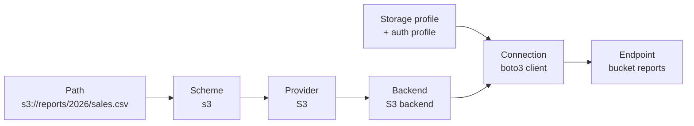

# What transport does

`mountainash-transport` gives Python code one file API across storage systems. The same calls read, write, stream, list, copy and delete on local disk, the S3 family (AWS S3, S3 Express, Cloudflare R2, MinIO and Backblaze B2), SFTP servers and HTTP(S) endpoints. The path you pass decides which system is used. Transport moves bytes and leaves their meaning to you.

This page assumes Python 3.12 or later, context managers and the standard binary I/O types (`bytes`, `io.BytesIO`, file objects opened in `"rb"` mode).

## Storage endpoints and paths

<!-- concept:101 -->

### Byte storage endpoints

A byte storage endpoint is any place that holds named sequences of bytes and lets a program fetch or store them by name. A directory on local disk is one. A bucket in an S3-compatible object store is another, as are a home directory on an SFTP server and a web server that answers `GET` (and sometimes `PUT`) for URLs. Each of these has its own client library, credentials, error types and rules about names: `pathlib` and `open()` for disk, `boto3` for S3, `paramiko` for SFTP, `httpx` for HTTP.

Transport puts one object in front of all of them. A `StorageFacade` is opened for an endpoint and offers the same methods whatever sits behind it: `read`, `write`, `read_stream`, `write_stream`, `list_objects`, `exists`, `get_size`, `metadata`, `delete`, `copy`, `list_dir`, `mkdir` and `rmdir`. Behind the facade, a backend translates those calls into the endpoint's own protocol. Transport has four storage backends:

| Backend | Endpoints | Client library |
|---|---|---|
| Local | Local and mounted filesystems | Python standard library |
| S3 family | AWS S3, S3 Express, R2, MinIO, B2 | `boto3` |
| SFTP | SSH file transfer servers | `paramiko` |
| HTTP | HTTP and HTTPS URLs | `httpx` |

Five further providers (Google Cloud Storage, Azure Blob and Files, FTP, SMB and GitHub repositories) have storage profiles and recognised URL schemes but no backend. Opening a facade for one of them from a path alone, with `StorageFacade.from_path`, raises `BackendNotImplementedError`. A facade built with one of their storage profiles fails earlier, while the connection is set up, with `TransportConnectionError` ([Settings-only providers](../../reference/support-matrix.md#settings-only-providers)). See [Specs, the registry and settings-only providers](../05-storage-profiles/index.md#specs-the-registry-and-settings-only-providers).

Not every endpoint can do everything. An HTTP server cannot be listed or asked to delete a file, and an object store has no directories. Each backend declares what it supports, and the facade refuses unsupported calls with `UnsupportedOperationError` instead of failing halfway. [Capabilities and supports()](../06-storage-facade/index.md#capabilities-and-supports) explains how to check before calling.

### The same calls on three endpoints

The example below reads one CSV file from local disk and from an HTTP server, then writes and reads it on an S3-compatible store. The local path and the HTTP URL need nothing but the path. The S3 store also needs a storage profile, which describes the store (here a MinIO-style endpoint), and an auth profile, which supplies credentials. The example ran against a local HTTP server and a local S3 test endpoint, and the code that starts those two servers is omitted; `local_path`, `http_url` and `moto_endpoint` are the values they produced.

```python
from mountainash_auth_client import IAMAuthProfile
from mountainash_transport import StorageFacade
from mountainash_transport.settings.storage.profiles import S3StorageProfile

data = b"region,total\nnorth,120\nsouth,95\n"

# Local disk: a bare path selects the local backend.
with StorageFacade.from_path(local_path) as storage:
    print("local:", storage.get_size(local_path), storage.read(local_path)[:12])

# HTTP: an http(s):// URL selects the HTTP backend.
with StorageFacade.from_path(http_url) as storage:
    print("http: ", storage.get_size(http_url), storage.read(http_url)[:12])

# S3: an s3:// URL selects the S3 backend; the store and credentials are described separately.
profile = S3StorageProfile(FLAVOR="minio", REGION="us-east-1", ENDPOINT_URL=moto_endpoint)
auth = IAMAuthProfile(ACCESS_KEY_ID="test", SECRET_ACCESS_KEY="test")
s3_url = "s3://reports/2026/sales.csv"
with StorageFacade.from_path(s3_url, profile, auth_profile=auth) as storage:
    storage.write(s3_url, data)
    print("s3:   ", storage.get_size(s3_url), storage.read(s3_url)[:12])
```

Output:

```text
local: 32 b'region,total'
http:  32 b'region,total'
s3:    32 b'region,total'
```

The calls are identical in all three blocks. Only the path and, for S3, the profiles differ. Storage profiles are covered in [Storage profiles and credentials](../05-storage-profiles/index.md), and the reason credentials come from a separate package is explained in [Credentials come from auth-client](../02-mountainash-ecosystem/index.md#credentials-come-from-auth-client).

<!-- concept:102 -->

### URL schemes and paths

Transport identifies an endpoint from the path's URL scheme, the part before `://`. A path with no scheme, such as `/data/sales.csv` or `reports/sales.csv`, is a local path. `file://` is also local. Every other scheme names a provider:

| Scheme | Provider | Backend |
|---|---|---|
| none, `file` | Local filesystem | Local |
| `s3`, `s3express`, `r2`, `minio`, `b2` | S3 family | S3 |
| `sftp` | SFTP | SFTP |
| `http`, `https` | HTTP(S) | HTTP |
| `gs` (alias `gcs`), `azure` (alias `az`), `ftp`, `smb`, `github`, `ssh` | Recognised | None |

The rest of the path addresses something inside the endpoint, and its meaning depends on the provider. In `s3://reports/2026/sales.csv` the first component (`reports`) is the bucket and the remainder (`2026/sales.csv`) is the object key. In `sftp://files.example.com/inbox/sales.csv` the first component is the server's host name and the remainder is a path on that server. In an `https://` URL the whole URL addresses the resource.

`detect_provider_from_path` shows the provider a path selects, without opening anything:

```python
from mountainash_transport import detect_provider_from_path

for path in (
    "/data/sales.csv",
    "file:///data/sales.csv",
    "s3://reports/2026/sales.csv",
    "r2://reports/2026/sales.csv",
    "sftp://files.example.com/inbox/sales.csv",
    "https://files.example.com/sales.csv",
    "gs://reports/2026/sales.csv",
):
    print(f"{path:42} -> {detect_provider_from_path(path).value}")

try:
    detect_provider_from_path("dropbox://reports/sales.csv")
except ValueError as error:
    print(error)
```

Output:

```text
/data/sales.csv                            -> local
file:///data/sales.csv                     -> local
s3://reports/2026/sales.csv                -> s3
r2://reports/2026/sales.csv                -> r2
sftp://files.example.com/inbox/sales.csv   -> sftp
https://files.example.com/sales.csv        -> http
gs://reports/2026/sales.csv                -> gcs
Unrecognised scheme in path 'dropbox://reports/sales.csv'
```

`gs://` is recognised as Google Cloud Storage even though no backend exists for it, and `StorageFacade.from_path` refuses it with `BackendNotImplementedError`. An unknown scheme is refused with `ValueError` before anything is opened.

The path drives everything that follows. `StorageFacade.from_path` reads the scheme, picks the provider, finds the backend registered for it and opens a connection described by the storage profile, if one is supplied:



The scheme table and dispatch rules are described in full in [How a path picks a backend](../04-paths-and-schemes/index.md#how-a-path-picks-a-backend).

<!-- concept:103 -->

### Object storage has keys, not directories

S3-family stores are object stores. A bucket holds objects, and each object has a key: a flat string such as `2026/q1/north.csv`. The slashes in a key are characters like any other. There is no `2026` directory to create first, and nothing to remove when the last object under `2026/` is deleted. Listing works by prefix: asking for keys that start with `2026/` returns every key below it, at any depth. A delimiter (usually `/`) groups the keys after the prefix into common prefixes, which look like subdirectories in a listing but are not stored anywhere.

Filesystems (local disk and SFTP) have real directories that exist independently of the files in them. Transport keeps the difference visible instead of imitating directories on object stores. The S3 backend does not implement the directory capability, so `mkdir` and `rmdir` raise `UnsupportedOperationError` there, and `list_objects` on S3 treats the path as a literal key prefix.

```python
from mountainash_auth_client import IAMAuthProfile
from mountainash_transport import StorageDirectoryProtocol, StorageFacade
from mountainash_transport.settings.storage.profiles import S3StorageProfile

profile = S3StorageProfile(FLAVOR="minio", REGION="us-east-1", ENDPOINT_URL=moto_endpoint)
auth = IAMAuthProfile(ACCESS_KEY_ID="test", SECRET_ACCESS_KEY="test")

with StorageFacade.from_path("s3://reports/", profile, auth_profile=auth) as storage:
    # No directory is created first: the key "2026/q1/north.csv" is just a name.
    storage.write("s3://reports/2026/q1/north.csv", b"north,120\n")
    storage.write("s3://reports/2026/q1/south.csv", b"south,95\n")
    storage.write("s3://reports/2026-draft.csv", b"draft\n")

    every_key = storage.list_objects("s3://reports/2026/", delimiter=None)
    print("keys:    ", sorted(entry.path for entry in every_key.objects))

    grouped = storage.list_objects("s3://reports/2026/")  # delimiter "/" groups keys
    print("prefixes:", [entry.path for entry in grouped.common_prefixes])
    print("directories supported:", storage.supports(StorageDirectoryProtocol))
```

Output:

```text
keys:     ['s3://reports/2026/q1/north.csv', 's3://reports/2026/q1/south.csv']
prefixes: ['s3://reports/2026/q1/']
directories supported: False
```

The prefix `2026/` excludes `2026-draft.csv`, because the selection is by literal prefix and that key does not start with `2026/`. The same S3 test endpoint as in the previous example was used, and its start-up code is omitted. Listing rules for every backend are in [Listing and metadata](../07-file-operations/index.md#listing-and-metadata).

## Bytes and streams

<!-- concept:104 -->

Transport works in bytes. `read(path)` returns a `bytes` object, and `write(path, data)` takes one. It never returns text, rows or data frames, and it never guesses an encoding.

Whole-object calls hold the complete payload in memory. For large objects, or when the data should flow through without being held at once, transport offers streams. A binary stream is a file-like object with a `read(n)` method that returns up to `n` bytes and `b""` at the end, the same interface as a file opened with `open(path, "rb")` or an `io.BytesIO`.

- `read_stream(path)` opens the stored object and returns a readable binary stream. Close it when done, preferably with a `with` block.
- `write_stream(path, source)` consumes any readable binary stream you supply and stores its bytes.

Streams are also where stream transforms apply. A transform such as `Gzip` or `GPG` changes the bytes on their way through: it encodes on write and decodes on read. You pass it with the keyword-only `pipeline=` argument, or ask transport to infer it from the file suffix on read with `infer=True`.

The example writes about 100 kB of log lines from an in-memory stream, compressed with gzip, then streams them back in 64 KiB chunks while decoding:

```python
import io
import tempfile
from pathlib import Path

from mountainash_transport import Gzip, StorageFacade

with tempfile.TemporaryDirectory() as root:
    path = str(Path(root) / "events.log.gz")
    source = io.BytesIO(b"".join(f"event {n}\n".encode() for n in range(10_000)))

    with StorageFacade.for_local() as storage:
        # Write from any readable binary stream; gzip is applied on the way out.
        storage.write_stream(path, source, pipeline=Gzip())
        print("stored bytes:", storage.get_size(path))

        # Read back as a binary stream, decoding gzip on the way in.
        with storage.read_stream(path, pipeline=Gzip()) as stream:
            first = stream.read(16)
            rest = sum(len(chunk) for chunk in iter(lambda: stream.read(64 * 1024), b""))
        print("first chunk:", first)
        print("decoded bytes:", len(first) + rest)
```

Output:

```text
stored bytes: 23018
first chunk: b'event 0\nevent 1\n'
decoded bytes: 108890
```

`get_size` reports the stored size, which is the compressed size, because metadata describes the object at the endpoint. The decoded length is only known after reading.

!!! warning "Gzip on write closes your source stream"
    When `write_stream` is given a `Gzip` pipeline, the caller's source stream is closed once the write finishes. Without a pipeline, a write to local disk leaves the source open. An S3-family `write_stream` closes the source after a small single-request upload and leaves it open after a multipart upload ([Reading and writing](../07-file-operations/index.md#reading-and-writing)). Do not rely on reusing the source object after a write. See the [support matrix and known limits](../../reference/support-matrix.md).

By default a stream from a remote endpoint is sequential: it reads forward and cannot seek. Formats that need to jump around a file, such as reading a footer first, need a different access mode. [Read access modes](../09-read-access-modes/index.md#choosing-an-access-mode) explains the sequential, random and buffered modes, and [Transforms and pipelines](../10-stream-transforms/index.md#transforms-and-pipelines) covers transforms in detail.

## What transport owns

<!-- concept:105 -->

Transport's job ends where the bytes acquire meaning. It owns the work of getting bytes to and from an endpoint, and it delegates everything that is about credentials, configuration loading or the content of the bytes.

| Transport owns | Owned elsewhere |
|---|---|
| Choosing a backend from the path's scheme | Credential types and OAuth token lifecycles: `mountainash-auth-client` |
| Connections: S3 clients, SSH and SFTP sessions, SSH tunnels, HTTP clients | Loading configuration files, environment variables and secret references: `mountainash-settings` |
| Moving bytes: read, write, stream, list, metadata, delete, copy, directories | File formats (CSV, Parquet, JSON and so on): consumers such as `mountainash-files` |
| Stream transforms (gzip, GPG) and suffix inference | Choosing an access mode for a format: the consumer |
| Read access modes and byte-range policies | Data frames and schemas: consumers such as `mountainash` |
| Location policy: which local roots and remote hosts code may reach | |
| Typed errors for storage, connection and HTTP failures | |

The split keeps transport usable by any consumer. A storage profile describes a store, but never holds a password or key; those arrive as an auth profile from `mountainash-auth-client`. Transport depends on no format library, so reading a Parquet file never pulls in PyArrow, and a CSV consumer does not inherit Parquet tuning. Where these boundaries come up in later pages, they link back to [Transport in the Mountainash ecosystem](../02-mountainash-ecosystem/index.md), which describes each neighbouring package.

In practice, transport hands back bytes and the caller decides what they are. Here transport locates the file, reads it and removes the gzip encoding, and the standard library's `csv` module does the interpretation:

```python
import csv
import io
import tempfile
from pathlib import Path

from mountainash_transport import Gzip, StorageFacade

with tempfile.TemporaryDirectory() as root:
    path = str(Path(root) / "sales.csv.gz")
    with StorageFacade.from_path(path) as storage:
        storage.write(path, b"region,total\nnorth,120\nsouth,95\n", pipeline=Gzip())

        # Transport: locate the store, move the bytes, undo the gzip encoding.
        data = storage.read(path, infer=True)

    # The caller: interpret the bytes as CSV.
    rows = list(csv.DictReader(io.StringIO(data.decode("utf-8"))))
    print(type(data).__name__, len(data))
    print(rows)
```

Output:

```text
bytes 32
[{'region': 'north', 'total': '120'}, {'region': 'south', 'total': '95'}]
```

Gzip is a transport concern because it is an encoding of the bytes that says nothing about their structure, and the same rule applies to every format. CSV is a format, so decoding text and splitting rows belongs to the caller. A Parquet reader would make the same split: it asks transport for a seekable stream and does all the Parquet work itself, as shown in [Formats belong to consumers](../02-mountainash-ecosystem/index.md#formats-belong-to-consumers).

The boundary also governs errors. Transport translates each client library's failures into its own public exceptions (`PathNotFoundError`, `AuthenticationError`, `StorageConnectionError` and others), so callers never need to catch `botocore` or `paramiko` types. The error families are listed in [Errors](../03-installation/index.md#errors).
