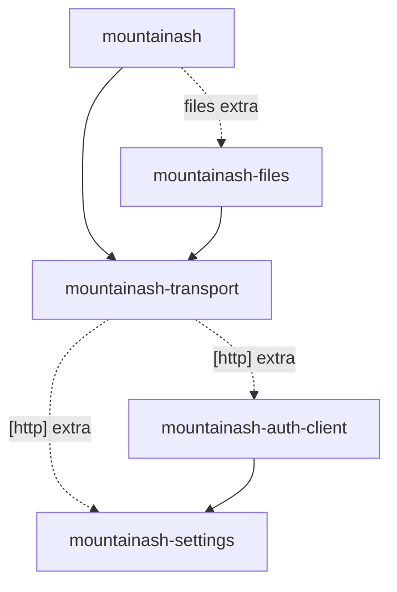

# Transport in the Mountainash ecosystem

`mountainash-transport` is the storage layer of the Mountainash packages. It connects to endpoints and moves bytes. Two packages below it supply credentials (`mountainash-auth-client`) and configuration (`mountainash-settings`). Two packages above it turn bytes into data: `mountainash-files` parses file formats, and `mountainash` builds data frames, relations and schemas.

This page assumes the vocabulary of [What transport does](../01-what-transport-does/index.md), in particular [What transport owns](../01-what-transport-does/index.md#what-transport-owns).

## The Mountainash packages

<!-- concept:106 -->

Mountainash is a set of Python packages that split data work by responsibility. Each package has one job and depends only on the packages beneath it. The five that meet at transport are:

| Package | Responsibility | Relation to transport |
|---|---|---|
| `mountainash-settings` | Configuration: settings classes, loading from files, environment and secret stores, the `Profile` base class and profile registries | Transport depends on it through the `[http]` extra |
| `mountainash-auth-client` | Credentials: auth profiles, rendering credentials for a target library, OAuth flows and token lifecycles | Transport depends on it through the `[http]` extra |
| `mountainash-transport` | Storage: backends, connections, byte movement, stream transforms, access modes, location policy | |
| `mountainash-files` | File formats: format specs, parsers, serialisers and schema inspection | Requires transport |
| `mountainash` | Cross-backend data frame expressions, relations and schema management | Requires transport; uses `mountainash-files` through its `files` extra |

The dependency declarations in each package's `pyproject.toml` form this map. Solid arrows are required dependencies and dotted arrows are optional extras:



The arrows point one way. Transport never imports `mountainash-files` or `mountainash`, and auth-client and settings never import transport. A package can therefore use transport without any format library, and transport can be installed without the packages above it.

The two lower packages are optional for transport itself. The base install depends only on `typing-extensions` and handles local files. Everything that involves remote endpoints, storage profiles or credentials needs the `[http]` extra, which brings in settings and auth-client (see [Base install and extras](../03-installation/index.md#base-install-and-extras)). The installed package metadata shows this directly:

```python
from importlib.metadata import requires

for requirement in requires("mountainash-transport"):
    unconditional = ";" not in requirement
    sibling_in_http = requirement.startswith("mountainash") and "extra == 'http'" in requirement
    if unconditional or sibling_in_http:
        print("transport  ->", requirement)

for requirement in requires("mountainash-auth-client"):
    if requirement.startswith("mountainash"):
        print("auth-client ->", requirement)
```

Output:

```text
transport  -> typing-extensions>=4.0
transport  -> mountainash-auth-client<0.2,>=0.1.0; extra == 'http'
transport  -> mountainash-settings<0.2,>=0.1.0; extra == 'http'
auth-client -> mountainash-settings<0.2,>=0.1.0
```

The packages above transport mirror its extras. `mountainash-files` declares `http`, `s3`, `gcs`, `azure`, `sftp` and `encryption` extras that each pull in the matching `mountainash-transport[...]` extra. `mountainash` declares an `http` extra that pulls in `mountainash-transport[http]`, while its `s3`, `gcs`, `azure` and `sftp` extras go through `mountainash-files`. Installing `mountainash-files[s3]` therefore installs transport with its S3 backend. The `gcs` and `azure` extras install SDKs, but transport has no backend for those providers yet.

## Credentials come from auth-client

<!-- concept:107 -->

### mountainash-auth-client

`mountainash-auth-client` owns credentials for the whole ecosystem. Its auth profiles describe one kind of credential each, independent of where it will be used: `IAMAuthProfile` (access keys, or a role to assume), `TokenAuthProfile`, `PasswordAuthProfile`, `OAuth2AuthProfile`, `NoAuthProfile` and others. A credential is data plus a set of renderers. `emit(target_family)` renders it in the shape a client library expects, keyed by target families that auth-client itself defines: HTTP (`httpx`), BOTO (`boto3`) and PARAMIKO (`paramiko`).

Auth-client also owns the OAuth layer: the OAuth 1.0a and 2.0 authorisation flows, local and manual callback servers, provider profiles and the token managers. A token manager's `acquire()` returns a valid token, refreshing it when stale, and `refresh()` forces a refresh. Auth-client acquires tokens; it does not build clients. The consumer that owns a target builds its own client from the rendered credential.

<!-- concept:111 -->

### How transport delegates credentials

Transport's storage profiles describe a store (region, bucket, endpoint, host, timeouts) and never hold credentials. Credentials arrive separately as an auth profile, and transport combines the two only when it opens a connection. `create_connection(profile, auth_profile)` and `StorageFacade.from_path(path, profile, auth_profile=...)` do three things:

1. Check the auth profile's mode against the modes the provider's spec declares in `supported_auth`. An S3 profile accepts `iam` or `none`, for example. A mismatch raises `UnsupportedAuthProfileError` before any I/O.
2. Map the provider to an auth-client target family: S3-family providers to BOTO, SFTP and SSH to PARAMIKO, HTTP to HTTP.
3. Build the client arguments from the profile's own emission, then layer `auth_profile.emit(family, base=...)` on top. For an S3 role or named AWS profile, transport builds a session description that the S3 connection uses to assume the role.

```python
from mountainash_auth_client import IAMAuthProfile, PasswordAuthProfile

from mountainash_transport import create_connection
from mountainash_transport.connections.errors import UnsupportedAuthProfileError
from mountainash_transport.settings.storage.profiles.s3_storage_profile import S3StorageProfile

profile = S3StorageProfile(FLAVOR="aws", REGION="ap-southeast-2", BUCKET="reports")
print("S3 profile carries:", sorted(profile.to_handler_kwargs()))

keys = IAMAuthProfile(ACCESS_KEY_ID="example-access-key", SECRET_ACCESS_KEY="example-secret")
connection = create_connection(profile, keys)  # validated and paired; no I/O yet
print("paired with", type(keys).__name__, "->", type(connection).__name__)

password = PasswordAuthProfile(USERNAME="report_user", PASSWORD="example-password")
try:
    create_connection(profile, password)
except UnsupportedAuthProfileError as error:
    print("refused:", error)
```

Output:

```text
S3 profile carries: ['config', 'region_name', 'service_name', 'use_ssl', 'verify']
paired with IAMAuthProfile -> S3Connection
refused: PasswordAuthProfile is not supported: mode 'password' not in supported_auth ['iam', 'none']
```

The storage profile's client arguments contain no key, secret or token. The same `IAMAuthProfile` could be paired with a different S3 profile, and the same S3 profile with a role instead of keys.

For managed OAuth2 over HTTP, transport does not run the flow. The application passes an `OAuth2AuthProfile`, an OAuth provider profile and a token store to `StorageFacade.from_path`. Transport builds auth-client's `OAuth2TokenManager` and adapts it to the HTTP engine's refreshable-auth interface: each request gets its `Authorization` header from `acquire()`, and a 401 response triggers one `refresh()` and a retry. The adapter lives in `src/mountainash_transport/connections/auth_strategy.py` and holds no OAuth policy of its own.

Auth profiles and their pairing with storage profiles are covered in [What a storage profile is](../05-storage-profiles/index.md#what-a-storage-profile-is). The HTTP side of OAuth is in [Authentication strategies](../12-http-engine/index.md#authentication-strategies).

## Configuration comes from settings

<!-- concept:108 -->

`mountainash-settings` owns configuration. It loads settings from environment variables, `.env` files, YAML, TOML and JSON files and secret directories, merges them in a defined order, and resolves secret references through a store that the application selects. It also provides the `Profile` base class with typed, declared fields, the `ProfileSpec` metadata that describes a profile class, and the `Registry` that maps names to profile classes.

Transport builds on these pieces rather than reading configuration itself:

| Transport piece | Built on settings |
|---|---|
| Storage profile classes (`S3StorageProfile`, `SFTPStorageProfile`, `HTTPStorageProfile` and the others) | `Profile` subclasses with declared fields and validation |
| `StorageProfileSpec`, the per-provider metadata (supported auth modes, implemented flag, SDK package) | Extends `ProfileSpec` with storage fields |
| `STORAGE_REGISTRY`, which maps provider names such as `s3` or `sftp` to profile classes | A settings `Registry` |
| `resolve_storage(name)`, which builds a storage profile and auth profile from configuration | `SettingsParameters`, settings loading and secret resolution |
| Token stores for managed OAuth | Settings' clearable secret store interface |

The facade and backends never read configuration. They receive finished profile objects. Configuration is resolved once, at the application's edge, by `resolve_storage`. It looks up a named block under `storage_profiles:` in the configuration that settings loads, builds the provider's profile class from `parameters`, and builds the auth profile from `auth`. A value written as `secret:<record>.<field>` is fetched from the secret store selected in `SettingsParameters`, so the configuration file holds references, not secrets.

```python
import tempfile
from pathlib import Path

from mountainash_settings import SettingsParameters
from mountainash_settings.secrets import MemorySecretStore

from mountainash_transport import resolve_storage

PROFILES = """
storage_profiles:
  lake:
    provider: s3
    parameters:
      FLAVOR: aws
      REGION: ap-southeast-2
      BUCKET: reports
    auth:
      mode: iam
      parameters:
        ACCESS_KEY_ID: example-access-key
        SECRET_ACCESS_KEY: "secret:aws.secret_key"
"""

with tempfile.TemporaryDirectory() as root:
    config = Path(root) / "profiles.yaml"
    config.write_text(PROFILES)

    secrets = MemorySecretStore()  # stands in for the application's secret store
    secrets.set("aws", {"secret_key": "resolved-from-the-store"})

    params = SettingsParameters.create(config_files=[str(config)], secret_store=secrets)
    profile, auth = resolve_storage("lake", settings_parameters=params)

print(type(profile).__name__, profile.FLAVOR, profile.REGION, profile.BUCKET)
print(type(auth).__name__, auth.SECRET_ACCESS_KEY)
print(auth.SECRET_ACCESS_KEY.get_secret_value())
```

Output:

```text
S3StorageProfile aws ap-southeast-2 reports
IAMAuthProfile **********
resolved-from-the-store
```

The secret is resolved from the store, not from the file, and is masked when printed. A production application would select a persistent store such as settings' `FilesystemBackend` instead of the in-memory one. When `settings_parameters` is omitted, `resolve_storage` reads the configuration file named by the `MOUNTAINASH_PROFILES_CONFIG` environment variable. A `secret:` reference without a selected store, a missing record or a failed lookup is an error. There is no fallback to environment variables or provider defaults.

Settings also owns the storage behind managed OAuth. The token store passed to `StorageFacade.from_path(..., token_store=...)` is a settings secret store, separate from the configuration reader. Transport borrows both stores and never closes them; the application keeps them open until its storage work is finished.

Named profiles and `resolve_storage` are covered in [Named profiles](../05-storage-profiles/index.md#named-profiles), and the spec and registry in [Specs, the registry and settings-only providers](../05-storage-profiles/index.md#specs-the-registry-and-settings-only-providers).

## Formats belong to consumers

<!-- concept:109 -->

### mountainash-files

`mountainash-files` parses and writes file formats. Each format is a frozen, serialisable spec plus capability functions (a required parser, an optional serialiser and an optional inspector), registered in a format registry that also accepts plugins. Tabular results are Arrow tables. Files owns the format engines, the type rules, and the choice of how each format reads its source.

Files reaches all storage through transport's public API, and its own configuration enforces this. The `pyproject.toml` of `mountainash-files` bans direct file and network access in its source (`pathlib.Path`, `os` file calls, `open()`, `shutil`, `httpx`, `boto3`, `paramiko`, `fsspec`, PyArrow's own file access) and bans every `mountainash_transport` submodule, so imports come only from the `mountainash_transport` package root. Profiles, credentials, transforms and location policy therefore apply to every file that files reads. A local-file shortcut would bypass all of them.

<!-- concept:110 -->

### mountainash relations readers

`mountainash` provides cross-backend data frame expressions, relations and schema management. It requires `mountainash-transport` directly. Reading data resources by format goes through `mountainash-files`, which `mountainash` installs with its `files` extra (the `ibis` extra includes it too), and its remote storage extras (`s3`, `gcs`, `azure`, `sftp`) are declared through `mountainash-files`. Files leaves type consistency across sources to its consumer, and `mountainash` conforms data to the target schema it was given.

For transport, `mountainash` is a consumer like files. It receives bytes, streams and typed errors, and does its own data work.

<!-- concept:112 -->

### Format-agnostic storage

Transport serves every format consumer, so it holds no format knowledge. It has no dependency on PyArrow, polars or pandas, and it does not choose an access mode or cache policy from a file extension. Transport's part is generic. It acquires bytes and handles, declares what each backend can do, and refuses unsupported requests with typed errors that a consumer can catch.

The consumer decides how to read. A format that needs a seekable source, such as one that reads a footer first, asks for `access="random"`. A format that parses a whole document asks for `read()`. When random access is impossible, the consumer falls back to `access="buffered"`. Files follows this pattern: it resolves the transform pipeline with the public `infer_pipeline` before asking for random access, and falls back to buffered reads on `RangeNotSupportedError` or `UnsupportedOperationError`.

The example below is such a consumer. It needs the last four bytes of a file. It checks for transforms first, because a gzip-compressed file cannot be read at random offsets, and it keeps a typed fallback:

```python
import tempfile
from pathlib import Path

from mountainash_transport import (
    Gzip, RangeNotSupportedError, StorageFacade, UnsupportedOperationError, infer_pipeline,
)


def read_trailer(storage: StorageFacade, path: str) -> tuple[str, bytes]:
    """A consumer that needs the last 4 bytes of a file, as a footer-based format would."""
    pipeline, _ = infer_pipeline(path)
    access = "random" if pipeline is None else "buffered"
    try:
        stream = storage.read_stream(path, access=access, pipeline=pipeline)
    except (RangeNotSupportedError, UnsupportedOperationError):
        access = "buffered"
        stream = storage.read_stream(path, access=access, pipeline=pipeline)
    with stream:
        stream.seek(-4, 2)
        return access, stream.read()


with tempfile.TemporaryDirectory() as root, StorageFacade.for_local() as storage:
    plain = str(Path(root) / "table.bin")
    packed = str(Path(root) / "table.bin.gz")
    storage.write(plain, b"rows...FOOT")
    storage.write(packed, b"rows...FOOT", pipeline=Gzip())

    print(Path(plain).name, read_trailer(storage, plain))
    print(Path(packed).name, read_trailer(storage, packed))
```

Output:

```text
table.bin ('random', b'FOOT')
table.bin.gz ('buffered', b'FOOT')
```

`infer_pipeline` returns `None` when the path has no transform suffix, and a pipeline (here `Gzip`) when it has one. Nothing in the consumer depends on the backend: the same function works for an `https://` or `s3://` path.

!!! note "Random access with transforms raises `ValueError`"
    Requesting `access="random"` together with a non-empty transform pipeline raises a plain `ValueError` ("access='random' cannot be combined with transforms"), not one of the typed refusals. Check the pipeline with `infer_pipeline` before choosing random access, as the example does. See the [support matrix and known limits](../../reference/support-matrix.md).

Access modes and range policies are covered in [Choosing an access mode](../09-read-access-modes/index.md#choosing-an-access-mode), and transforms on random reads in [Limits and ownership](../10-stream-transforms/index.md#limits-and-ownership).
