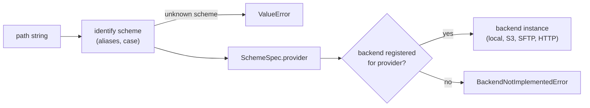

# Paths and scheme dispatch

Every storage call in mountainash-transport starts from a path string. The path's URL scheme (`s3://`, `sftp://`, `https://`, or none at all for a local file) names a provider type, and the provider type selects the backend that does the work. `StoragePath` and the S3 path helpers parse and normalise those strings without touching storage, and `infer_pipeline` reads a path's compression and encryption suffixes.

This page assumes the vocabulary from [storage endpoints and paths](../01-what-transport-does/index.md#storage-endpoints-and-paths): an endpoint is a place that stores bytes, and a path names one object or file within it.

## How a path picks a backend

<!-- concept:118 -->

### The scheme registry

Transport keeps one table of the URL schemes it recognises. Each entry is a `SchemeSpec` with four fields:

| Field | Meaning |
|---|---|
| `scheme` | The canonical lowercase token, such as `s3` or `gs`. The empty string stands for a bare local path. |
| `aliases` | Other prefixes that resolve to the canonical token. `gcs://` resolves to `gs`, and `az://` to `azure`. |
| `strict` | Whether `StoragePath.normalize` rejects a mixed-case scheme such as `S3://`. Only the bare-local entry is not strict. |
| `provider` | The `CONST_STORAGE_PROVIDER_TYPE` member the scheme routes to. |

The table lives in `src/mountainash_transport/_schemes.py`. It is private: you use it through `StoragePath.identify_scheme`, `detect_provider_from_path` and the location policy, which all read the same table. That shared source is deliberate. The scheme that decides which backend runs is the same scheme that [location policy](../08-location-policy/index.md#locationpolicy) checks, so the two cannot disagree about what a path means.

Recognising a scheme does not mean a backend exists for it. The registry is a parsing table; backends are registered separately (see [the backend registry](../13-architecture/index.md#the-backend-registry)). The current mapping is:

| Scheme | Aliases | Provider type | Backend |
|---|---|---|---|
| none (bare path), `file` | | `local` | Local |
| `s3` | | `s3` | S3 family |
| `s3express` | | `s3express` | S3 family |
| `r2` | | `r2` | S3 family |
| `minio` | | `minio` | S3 family |
| `b2` | | `b2` | S3 family |
| `sftp` | | `sftp` | SFTP |
| `http`, `https` | | `http` | HTTP |
| `gs` | `gcs` | `gcs` | none |
| `azure` | `az` | `azure_blob` | none |
| `ftp` | | `ftp` | none |
| `smb` | | `smb` | none |
| `github` | | `github` | none |
| `ssh` | | `ssh` | none |

The five S3-compatible schemes each map to their own provider type, and one S3 backend class is registered for all five. The scheme says which family a path belongs to; the [storage profile](../05-storage-profiles/index.md#provider-profiles) says which endpoint, region and addressing style to use. `ssh` is recognised because SSH is a connection type in transport (see [leaf connections](../11-connections/index.md#leaf-connections)), but there is no storage backend that reads or writes over a plain `ssh://` path. Two provider types, `nfs` and `azure_files`, exist in the enum with no scheme at all.

Scheme identification is case-insensitive and resolves aliases. A scheme that is not in the table is reported as unknown (`None`), not guessed.

<!-- concept:119 -->

### From path to backend

Dispatch is a short chain. `StoragePath.identify_scheme` returns the canonical scheme, the scheme's `SchemeSpec` gives the provider type, and the backend registry returns the backend class registered for that provider type. `StorageFacade.from_path` runs this chain for you; `detect_provider_from_path` exposes the first two steps on their own.



The following example asks for the scheme and provider type of several paths:

```python
from mountainash_transport import StoragePath, detect_provider_from_path

for path in [
    "/srv/reports/sales.csv",
    "file:///srv/reports/sales.csv",
    "s3://reports/2026/sales.csv",
    "r2://reports/2026/sales.csv",
    "gcs://reports/2026/sales.csv",
    "sftp://files.example.com/reports/sales.csv",
    "https://files.example.com/reports/sales.csv",
]:
    scheme = StoragePath.identify_scheme(path)
    provider = detect_provider_from_path(path)
    print(f"{path:45} scheme={scheme!r:9} provider={provider.value}")

print(StoragePath.identify_scheme("nfs://server/share/x"))
try:
    detect_provider_from_path("nfs://server/share/x")
except ValueError as exc:
    print(f"ValueError: {exc}")
```

Output:

```text
/srv/reports/sales.csv                        scheme=''        provider=local
file:///srv/reports/sales.csv                 scheme='file'    provider=local
s3://reports/2026/sales.csv                   scheme='s3'      provider=s3
r2://reports/2026/sales.csv                   scheme='r2'      provider=r2
gcs://reports/2026/sales.csv                  scheme='gs'      provider=gcs
sftp://files.example.com/reports/sales.csv    scheme='sftp'    provider=sftp
https://files.example.com/reports/sales.csv   scheme='https'   provider=http
None
ValueError: Unrecognised scheme in path 'nfs://server/share/x'
```

`gcs://` resolved to the canonical `gs` scheme and the `gcs` provider type. `nfs://` is not in the table, so identification returns `None` and provider detection raises `ValueError`.

A recognised scheme with no backend fails at the registry step instead. The error names the provider and lists the provider types that do have a backend:

```python
from mountainash_transport import BackendNotImplementedError, StorageFacade

try:
    StorageFacade.from_path("gs://reports/2026/sales.csv")
except BackendNotImplementedError as exc:
    print(f"{type(exc).__name__}: {exc}")
```

Output:

```text
BackendNotImplementedError: The 'gcs' storage provider is not yet implemented. Implemented providers: ['b2', 'http', 'local', 'minio', 'r2', 's3', 's3express', 'sftp']
```

`BackendNotImplementedError` is a `StorageError`, so it sits in the same hierarchy as every other storage failure (see [errors](../03-installation/index.md#errors)). [Settings-only providers](../05-storage-profiles/index.md#specs-the-registry-and-settings-only-providers) explains which providers are in this state and why their profiles exist anyway.

Dispatch reads only the path. It does not look at the storage profile you pass alongside it, so a profile cannot redirect an `s3://` path to a different backend. To choose the backend yourself, construct `StorageFacade` with a provider type instead of calling `from_path` (see [creating a facade](../06-storage-facade/index.md#creating-a-facade)).

`identify_scheme` and `detect_provider_from_path` are lenient about form: they accept `S3://bucket/key` and even `s3:bucket/key`. `StoragePath.normalize`, described next, is strict about both. Code that needs to reject malformed input should normalise the path first.

For maintainers, the dispatch pieces are `src/mountainash_transport/_schemes.py` (the table), `src/mountainash_transport/location.py` (`identify_scheme`, shared with policy checks) and `src/mountainash_transport/storage/registry/backend_detection.py` (`detect_provider_from_path`). Adding a scheme for a new backend is covered in [adding a backend](../15-maintaining/index.md#adding-a-backend).

## StoragePath

<!-- concept:120 -->

`StoragePath` is a stateless helper: every method is a classmethod, and none of them dispatch to a backend or perform I/O. It needs the `[http]` extra, which provides `universal_pathlib`; on a base install, accessing it raises `MissingExtraError` (see [base install and extras](../03-installation/index.md#base-install-and-extras)).

| Method | Returns |
|---|---|
| `identify_scheme(path)` | The canonical scheme, `""` for a bare local path, or `None` for an unknown scheme. |
| `normalize(path)` | A canonical path object, or `None` for `None` or an empty string. Raises `ValueError` for malformed input. |
| `join(path, name)` | `normalize(path)` with `name` appended. Leading and trailing slashes on `name` are stripped. |
| `matches(pattern, name)` | `fnmatch` wildcard matching with `*` and `?`. |
| `to_str(path)` | `str(path)`, passing `None` through. |

`normalize` rewrites the scheme to its canonical form, removes a trailing slash, and expands `~` in bare local paths. For schemes that the fsspec-based `UPath` library supports it returns a `UPath`; for registry schemes that `UPath` cannot construct (such as `azure`, `b2` and `smb`) it returns a plain string subclass with the canonical URL. Treat the result as path-like and call `str()` on it when you need text. It rejects mixed-case schemes, a scheme without `//` after the colon, and unknown schemes.

```python
from mountainash_transport import StoragePath

print(repr(StoragePath.normalize("s3://reports/2026/")))
print(repr(StoragePath.normalize("reports/2026/")))
print(repr(StoragePath.normalize("azure://reports/2026/")))
print(StoragePath.join("s3://reports/2026", "/sales.csv"))
print(StoragePath.matches("*.csv", "sales.csv"), StoragePath.matches("*.csv", "sales.json"))

for bad in ["S3://reports/2026", "nfs://server/share"]:
    try:
        StoragePath.normalize(bad)
    except ValueError as exc:
        print(f"ValueError: {exc}")
```

Output:

```text
S3Path('s3://reports/2026')
PosixUPath('reports/2026')
'azure://reports/2026'
s3://reports/2026/sales.csv
True False
ValueError: mixed-case scheme not accepted: 'S3' (expected lowercase canonical 's3')
ValueError: Unknown scheme in path: 'nfs://server/share'
```

The `azure://` path normalised to a string because no backend-independent `UPath` class exists for it. Normalising a path never implies that a backend is available; dispatch decides that.

<!-- concept:121 -->

### S3 bucket and key parsing

An S3-family path has two parts: the bucket in the URL's host position and the object key after it. `s3_bucket` and `s3_key` in `mountainash_transport.storage.path_helpers.s3` split them. Both accept any of the five S3-family schemes, validate the path with `StoragePath.normalize` first, and return `None` rather than raising when the path is not an addressable S3 path, so you can branch on the result.

The helpers enforce one rule worth knowing: a path never carries an endpoint. If the host position contains a port, as in `minio://localhost:9000/reports/sales.csv`, the helpers return `None`, because the endpoint belongs on the [storage profile](../05-storage-profiles/index.md#provider-profiles) and the path only names the bucket. For bare strings that you know are S3 locations, `assume_s3=True` reads the first segment as the bucket.

```python
from mountainash_transport.storage.path_helpers.s3 import s3_bucket, s3_key

print(s3_bucket("s3://reports/2026/sales.csv"), s3_key("s3://reports/2026/sales.csv"))
print(s3_bucket("minio://reports/2026/sales.csv"), repr(s3_key("r2://reports/")))
print(s3_bucket("minio://localhost:9000/reports/sales.csv"))
print(s3_bucket("/srv/reports/sales.csv"))
print(s3_bucket("reports/2026/sales.csv", assume_s3=True),
      s3_key("reports/2026/sales.csv", assume_s3=True))
```

Output:

```text
reports 2026/sales.csv
reports ''
None
None
reports 2026/sales.csv
```

The key has no leading slash, and a bucket-only path has an empty key. These are the same bucket names that [location policy](../08-location-policy/index.md#allowing-remote-hosts) checks against an S3 allow-list.

<!-- concept:122 -->

### Suffix chains

A file name can record how its bytes were stored: `sales.csv.gz` is gzip-compressed and `sales.csv.gz.gpg` is gzip-compressed and then GPG-encrypted. `infer_pipeline(path)` reads that suffix chain from right to left and returns `(pipeline, stripped_path)`, where `pipeline` is a transform pipeline (or `None` when no known suffix is present) and `stripped_path` is the path with the recognised suffixes removed.

| Suffix | Transform |
|---|---|
| `.gz`, `.gzip` | gzip |
| `.gpg`, `.asc`, `.pgp` | GPG |

Matching is case-insensitive and stops at the first suffix that is not in the table, so `report.v2.csv.gz` strips only `.gz`. A GPG suffix needs key material, so you pass `gpg=GPG(...)`; without it, `infer_pipeline` raises `ValueError`.

```python
from mountainash_transport import infer_pipeline

pipeline, stored_as = infer_pipeline("s3://reports/2026/sales.csv.gz")
print(type(pipeline).__name__, stored_as)

pipeline, stored_as = infer_pipeline("s3://reports/2026/sales.csv")
print(pipeline, stored_as)

try:
    infer_pipeline("s3://reports/2026/sales.csv.gz.gpg")
except ValueError as exc:
    print(f"ValueError: {exc}")
```

Output:

```text
Pipeline s3://reports/2026/sales.csv
None s3://reports/2026/sales.csv
ValueError: path 's3://reports/2026/sales.csv.gz.gpg' has a .gpg suffix; pass gpg=GPG(...) to infer
```

`StorageFacade.read` and `read_stream` accept `infer=True` to decode a file through its inferred pipeline; writes take an explicit `pipeline`. [Suffix inference](../10-stream-transforms/index.md#suffix-inference) covers that use, and [transforms and pipelines](../10-stream-transforms/index.md#transforms-and-pipelines) explains what a pipeline does to the bytes.
