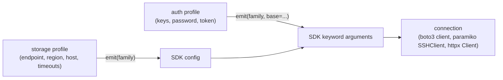

# Storage profiles and credentials

A storage profile describes a store: which endpoint, region, bucket or host to reach, and how to talk to it (timeouts, TLS verification, addressing style). An auth profile, from `mountainash-auth-client`, carries the credentials separately. Transport pairs the two when it opens a connection, checks that the pairing is one the provider supports, and turns both into the keyword arguments that boto3, paramiko or httpx expect. Named profiles let you keep both halves in configuration and load them by name with `resolve_storage`.

This page assumes the ownership split described in [transport in the Mountainash ecosystem](../02-mountainash-ecosystem/index.md): credentials come from `mountainash-auth-client` and configuration loading from `mountainash-settings`. Storage profiles need the `[http]` extra, which installs both (see [base install and extras](../03-installation/index.md#base-install-and-extras)).

## What a storage profile is

<!-- concept:129 -->

A storage profile is an instance of a provider's profile class. Each class is a `mountainash-settings` `Profile`, so its fields are declared once on a spec, validated when you construct the object, and can be filled from keyword arguments, environment or configuration files (see [configuration comes from settings](../02-mountainash-ecosystem/index.md#configuration-comes-from-settings)). Field names are uppercase, matching the configuration keys you would write in YAML.

The profile classes live in `mountainash_transport.settings.storage.profiles`:

| Class | Registry name | Provider type | Backend |
|---|---|---|---|
| `LocalStorageProfile` | `local` | `local` | yes |
| `S3StorageProfile` | `s3` | `s3` (and the other S3 flavours) | yes |
| `SFTPStorageProfile` | `sftp` | `sftp` | yes |
| `HTTPStorageProfile` | `http` | `http` | yes |
| `GCSStorageProfile` | `gcs` | `gcs` | no, settings only |
| `AzureStorageProfile` | `azure_storage` | `azure_blob` | no, settings only |
| `FTPStorageProfile` | `ftp` | `ftp` | no, settings only |
| `SMBStorageProfile` | `smb` | `smb` | no, settings only |
| `GitHubRepoStorageProfile` | `github_repo` | `github` | no, settings only |

The last five are explained in [settings-only providers](#specs-the-registry-and-settings-only-providers) below.

Every storage profile satisfies `StorageProfileProtocol`, which asks for two methods. `to_handler_kwargs()` returns the SDK configuration the profile describes, and `get_connection_url()` returns a best-effort URL for logs and diagnostics. Neither includes credentials: a profile has no password, key or token fields. That separation is what lets the same profile be used with different credentials in different environments, and it keeps profiles safe to print.

```python
from mountainash_transport.settings.storage.profiles import (
    HTTPStorageProfile, S3StorageProfile, SFTPStorageProfile,
)

lake = S3StorageProfile(FLAVOR="aws", REGION="ap-southeast-2", BUCKET="reports")
files = SFTPStorageProfile(HOST="files.example.com", USERNAME="reports")
web = HTTPStorageProfile(TIMEOUT_READ=60.0)

for profile in (lake, files, web):
    print(f"{type(profile).__name__:20} {profile.get_connection_url()}")
```

Output:

```text
S3StorageProfile     https://s3.ap-southeast-2.amazonaws.com
SFTPStorageProfile   sftp://reports@files.example.com:22
HTTPStorageProfile   http(s)://<dynamic>
```

The HTTP profile has no host: HTTP paths are full URLs, so the profile only describes client behaviour. A profile is passed to `StorageFacade` as its second argument, with the auth profile as `auth_profile=` (see [creating a facade](../06-storage-facade/index.md#creating-a-facade)). The facade hands both to `create_connection`, which builds the connection, and the profile to the backend.

Validation happens at construction. An invalid value raises pydantic's `ValidationError` naming the field, for example an unknown `FLAVOR` on an S3 profile or a GCS bucket name shorter than three characters. Some rules depend on several fields and are checked when the SDK arguments are built instead, such as MinIO's required endpoint shown under [S3 flavours](#s3-flavours).

<!-- concept:131 -->

### Provider types

A provider type is a member of `CONST_STORAGE_PROVIDER_TYPE`. It is the key that connects the three layers of transport: a path's scheme maps to a provider type (see [how a path picks a backend](../04-paths-and-schemes/index.md#how-a-path-picks-a-backend)), each profile class declares one on its spec, and backends are registered against one.

```python
from mountainash_transport import CONST_STORAGE_PROVIDER_TYPE

print([member.value for member in CONST_STORAGE_PROVIDER_TYPE])
```

Output:

```text
['local', 's3', 's3express', 'azure_blob', 'azure_files', 'gcs', 'sftp', 'ftp', 'smb', 'nfs', 'minio', 'ssh', 'b2', 'github', 'r2', 'http']
```

The enum lists every provider transport can name, which is more than it can serve. Backends exist for `local`, the five S3 types (`s3`, `s3express`, `r2`, `minio`, `b2`), `sftp` and `http`. `ssh` is a connection type used for SFTP and bastion tunnels, not a storage backend. `nfs` and `azure_files` have no URL scheme and no backend.

The provider type you give `StorageFacade` (or that `from_path` derives from the path) decides which backend runs. The profile's own provider type decides which connection class and SDK family `create_connection` uses. For the S3 family these differ on purpose: `S3StorageProfile` always declares `s3`, and its `FLAVOR` field, not the provider type, selects R2, MinIO, B2 or S3 Express behaviour.

<!-- concept:130 -->

### Auth profiles

Credentials live in auth profiles from `mountainash-auth-client`: `IAMAuthProfile` (AWS keys, session token, role or named AWS profile), `PasswordAuthProfile`, `TokenAuthProfile`, `JWTAuthProfile`, `CertificateAuthProfile`, `KerberosAuthProfile`, `OAuth2AuthProfile`, `NoAuthProfile` and others. Transport never defines credential fields of its own; it reads what an auth profile emits (see [credentials come from auth-client](../02-mountainash-ecosystem/index.md#credentials-come-from-auth-client)).

Each storage provider declares the auth modes it accepts. S3 accepts `iam` and `none`; SFTP accepts `password`, `certificate`, `kerberos` and `none`; HTTP accepts `none`, `token`, `password` and `oauth2`; local accepts only `none`. `create_connection` checks the pairing before any network I/O, and passing no auth profile counts as mode `none`.

```python
from mountainash_auth_client import IAMAuthProfile, PasswordAuthProfile
from mountainash_transport import create_connection
from mountainash_transport.connections.errors import UnsupportedAuthProfileError
from mountainash_transport.settings.storage.profiles import S3StorageProfile

lake = S3StorageProfile(FLAVOR="aws", REGION="ap-southeast-2", BUCKET="reports")
r2 = S3StorageProfile(FLAVOR="r2", ACCOUNT_ID="abc123", BUCKET="reports")
keys = IAMAuthProfile(ACCESS_KEY_ID="example-access-key", SECRET_ACCESS_KEY="example-secret")
role = IAMAuthProfile(ROLE_ARN="arn:aws:iam::123456789012:role/reports-reader")
password = PasswordAuthProfile(USERNAME="report_user", PASSWORD="example-password")

print(type(create_connection(lake, keys)).__name__)
for profile, auth in ((lake, password), (r2, role)):
    try:
        create_connection(profile, auth)
    except (UnsupportedAuthProfileError, ValueError) as exc:
        print(f"{type(exc).__name__}: {exc}")
```

Output:

```text
S3Connection
UnsupportedAuthProfileError: PasswordAuthProfile is not supported: mode 'password' not in supported_auth ['iam', 'none']
ValueError: assume-role (ROLE_ARN) is not supported for S3 flavor 'r2'; only aws/express reach AWS STS.
```

The connection was created but not opened; nothing contacted AWS. The second rejection is flavour-specific: assuming an IAM role goes through AWS STS, which only the `aws` and `express` flavours reach. Managed OAuth2 with token refresh is an HTTP-only feature covered in [authentication strategies](../12-http-engine/index.md#authentication-strategies).

## Provider profiles

<!-- concept:136 -->

### S3 flavours

One profile class, `S3StorageProfile`, covers AWS S3, S3 Express One Zone, Cloudflare R2, MinIO and Backblaze B2. The `FLAVOR` field (`aws`, `express`, `r2`, `minio` or `b2`, default `aws`) changes how the endpoint, region and addressing style are derived. The bucket is not part of the client configuration: `BUCKET` is optional metadata that also grants that bucket under [location policy](../08-location-policy/index.md#allowing-remote-hosts), and each path names its own bucket.

| Flavour | Endpoint | Region | Addressing |
|---|---|---|---|
| `aws` | boto3 default resolver | `REGION` | `ADDRESSING_STYLE` |
| `express` | boto3 default resolver | `REGION` | always `virtual` |
| `r2` | `https://{ACCOUNT_ID}.r2.cloudflarestorage.com`, or `ENDPOINT_URL` | always `auto` | `ADDRESSING_STYLE` |
| `minio` | `ENDPOINT_URL`, required | `REGION` | `ADDRESSING_STYLE` |
| `b2` | `https://s3.{REGION}.backblazeb2.com`, or `ENDPOINT_URL` | `REGION` | `ADDRESSING_STYLE` |

An explicit `ENDPOINT_URL` wins for every flavour. Other fields are `USE_SSL`, `VERIFY_SSL`, `CONNECT_TIMEOUT`, `READ_TIMEOUT`, and the AWS-only `ACCELERATE_ENDPOINT` and `DUALSTACK_ENDPOINT`. The `RANGE_CACHE`, `RANGE_BLOCK_SIZE` and `RANGE_MAX_BLOCKS` fields tune random-access reads (see [range tuning](../09-read-access-modes/index.md#range-tuning)).

```python
from mountainash_transport.settings.storage.profiles import S3StorageProfile

flavours = {
    "aws": S3StorageProfile(FLAVOR="aws", REGION="ap-southeast-2", BUCKET="reports"),
    "express": S3StorageProfile(FLAVOR="express", REGION="us-west-2",
                                BUCKET="reports--usw2-az1--x-s3"),
    "r2": S3StorageProfile(FLAVOR="r2", ACCOUNT_ID="abc123", BUCKET="reports"),
    "minio": S3StorageProfile(FLAVOR="minio", ENDPOINT_URL="http://127.0.0.1:9000"),
    "b2": S3StorageProfile(FLAVOR="b2", REGION="us-west-004", BUCKET="reports"),
}
for name, profile in flavours.items():
    kwargs = profile.to_handler_kwargs()
    print(f"{name:8} region={kwargs['region_name']:15} "
          f"endpoint={kwargs.get('endpoint_url')} "
          f"addressing={kwargs['config'].s3['addressing_style']}")

try:
    S3StorageProfile(FLAVOR="minio").to_handler_kwargs()
except ValueError as exc:
    print(f"ValueError: {exc}")
```

Output:

```text
aws      region=ap-southeast-2  endpoint=None addressing=auto
express  region=us-west-2       endpoint=None addressing=virtual
r2       region=auto            endpoint=https://abc123.r2.cloudflarestorage.com addressing=auto
minio    region=us-east-1       endpoint=http://127.0.0.1:9000 addressing=auto
b2       region=us-west-004     endpoint=https://s3.us-west-004.backblazeb2.com addressing=auto
ValueError: MinIO flavor requires an explicit ENDPOINT_URL.
```

The same rules apply whichever S3-family scheme a path uses: `s3://`, `r2://`, `minio://`, `b2://` and `s3express://` all reach the same backend, and the profile supplies the endpoint. A missing MinIO endpoint, or an R2 profile with neither `ACCOUNT_ID` nor `ENDPOINT_URL`, raises `ValueError` when the arguments are built, which happens when a connection is created.

<!-- concept:137 -->

### SFTP profile

`SFTPStorageProfile` describes an SSH server used through its SFTP subsystem. `HOST` and `USERNAME` are required; `PORT` defaults to 22. The remaining fields map to paramiko's `SSHClient.connect`: `TIMEOUT`, `BANNER_TIMEOUT`, `AUTH_TIMEOUT`, `ALLOW_AGENT`, `LOOK_FOR_KEYS` and `COMPRESS`. Host-key checking is set by `KNOWN_HOSTS_FILE` and `HOST_KEY_POLICY`, which defaults to `reject` (refuse hosts whose key is not known). `warn` and `auto_add` connect to unknown hosts and allow a man-in-the-middle on first contact.

```python
from mountainash_transport.settings.storage.profiles import HTTPStorageProfile, SFTPStorageProfile

files = SFTPStorageProfile(HOST="files.example.com", USERNAME="reports",
                           KNOWN_HOSTS_FILE="~/.ssh/known_hosts")
print(files.to_handler_kwargs())
```

Output:

```text
{'hostname': 'files.example.com', 'port': 22, 'username': 'reports', 'timeout': 30.0, 'allow_agent': True, 'look_for_keys': True, 'compress': False, '_post_connect': {'known_hosts_file': '~/.ssh/known_hosts', 'host_key_policy': 'reject'}}
```

The host-key settings travel in a separate envelope because paramiko applies them to the client rather than as `connect()` arguments. A password, key file or Kerberos ticket comes from the auth profile. [Leaf connections](../11-connections/index.md#leaf-connections) describes how `SSHConnection` uses these arguments.

<!-- concept:138 -->

### HTTP profile

`HTTPStorageProfile` describes an httpx client, not a server: `TIMEOUT_CONNECT` (10 s), `TIMEOUT_READ` (30 s), `TIMEOUT_WRITE` (60 s), `FOLLOW_REDIRECTS` (on), `MAX_REDIRECTS` (10), `VERIFY_SSL` (on) and `HEADERS`, plus the `RANGE_*` fields. The URL comes from each path. When you open an HTTP facade without a profile, transport uses a default `HTTPStorageProfile`.

```python
web = HTTPStorageProfile(HEADERS={"User-Agent": "reports-sync"}, FOLLOW_REDIRECTS=False)
print(web.to_handler_kwargs())
```

Output:

```text
{'timeout': Timeout(connect=10.0, read=30.0, write=60.0, pool=5.0), 'follow_redirects': False, 'max_redirects': 10, 'verify': True, 'headers': {'User-Agent': 'reports-sync'}}
```

Authorization headers are added from the auth profile and merged with `HEADERS`. Request behaviour beyond the client settings, such as retries, is configured on the [HTTP request engine](../12-http-engine/index.md#making-requests).

## Specs, the registry and settings-only providers

<!-- concept:132 -->

### StorageProfileSpec

Each profile class is generated from a `StorageProfileSpec`, a frozen dataclass that extends the `ProfileSpec` from `mountainash-settings` with storage-specific metadata. The spec is the single description of a provider: the profile class reads its fields from it, `resolve_storage` reads its auth rules from it, and the registry indexes it.

| Field | Meaning |
|---|---|
| `name` | Registry key, such as `s3` or `azure_storage`. |
| `provider_type` | The `CONST_STORAGE_PROVIDER_TYPE` member. |
| `parameters` | `ParameterSpec` entries: name, type, default, tier (`core` or `advanced`), description and optional validator. These become the profile's fields. |
| `sdk_package` | The PyPI package of the SDK, or `None` for stdlib-only providers. |
| `handler_module`, `handler_class` | Where the backend class lives or is expected to live. |
| `supports_streaming`, `supports_multipart`, `read_only` | Provider capabilities as declared metadata. |
| `default_auth` | The auth mode `resolve_storage` uses when configuration names none. |
| `supported_auth` | Every auth mode the provider accepts. |
| `implemented` | Whether transport has a backend for the provider. |

You read a spec with `get_spec(name)` from `mountainash_transport.settings.storage.registry`, as the next example shows. Runtime capability checks use the backend, not these declared fields: call `StorageFacade.supports()` (see [capabilities and supports()](../06-storage-facade/index.md#capabilities-and-supports)).

<!-- concept:133 -->

### The implemented flag

`implemented` records whether a backend exists. It is `True` for `local`, `s3`, `sftp` and `http`, and `False` for the five providers whose profiles exist without a backend. The flag is declared on the spec and does not change at runtime; the backend registry is what dispatch actually consults. `tests/storage/protocols/test_registry_completeness.py` asserts that `implemented` is `True` exactly when a backend is registered (see [tests that guard the contracts](../15-maintaining/index.md#tests-that-guard-the-contracts)).

```python
from mountainash_transport.settings.storage.registry import STORAGE_REGISTRY

for name in sorted(STORAGE_REGISTRY.specs):
    spec = STORAGE_REGISTRY.get_spec(name)
    cls = STORAGE_REGISTRY.get_settings_class(name)
    auth = ",".join(sorted(mode.value for mode in spec.supported_auth))
    print(f"{name:13} {cls.__name__:24} provider={spec.provider_type.value:10} "
          f"implemented={spec.implemented!s:5} default_auth={spec.default_auth.value}")
```

Output:

```text
azure_storage AzureStorageProfile      provider=azure_blob implemented=False default_auth=azure_ad
ftp           FTPStorageProfile        provider=ftp        implemented=False default_auth=password
gcs           GCSStorageProfile        provider=gcs        implemented=False default_auth=service_account
github_repo   GitHubRepoStorageProfile provider=github     implemented=False default_auth=token
http          HTTPStorageProfile       provider=http       implemented=True  default_auth=none
local         LocalStorageProfile      provider=local      implemented=True  default_auth=none
s3            S3StorageProfile         provider=s3         implemented=True  default_auth=iam
sftp          SFTPStorageProfile       provider=sftp       implemented=True  default_auth=password
smb           SMBStorageProfile        provider=smb        implemented=False default_auth=password
```

<!-- concept:134 -->

### Settings-only providers

GCS, Azure Storage, FTP/FTPS, SMB and GitHub repositories are settings-only providers. Their profile classes are complete: they validate their fields, produce a connection URL, appear in the registry and can be loaded by name with `resolve_storage`. What they lack is a backend, so no storage operation can run against them. They exist so that configuration for these stores can be written, validated and shared now, with the same shape a future backend will consume.

!!! warning "No backend for GCS, Azure, FTP, SMB or GitHub"
    Only local files, the S3 family, SFTP and HTTP(S) have backends. Installing the `[gcs]` or `[azure]` extra installs the vendor SDK but does not add a backend. Opening storage for a settings-only provider fails; see the error behaviour below and the [support matrix](../../reference/support-matrix.md).

<!-- concept:220 -->

### BackendNotImplementedError

`BackendNotImplementedError` is the `StorageError` subclass raised when the backend registry has no backend for a recognised provider type. Its message lists the provider types that are implemented. It is raised by `StorageFacade.from_path` for a settings-only scheme and by `get_storage_backend` for a settings-only provider type, with or without a profile:

```python
from mountainash_transport import (
    CONST_STORAGE_PROVIDER_TYPE, BackendNotImplementedError, StorageFacade,
    get_storage_backend,
)
from mountainash_transport.settings.storage.profiles import GCSStorageProfile

try:
    StorageFacade.from_path("gs://reports/2026/sales.csv")
except BackendNotImplementedError as exc:
    print(f"{type(exc).__name__}: {exc}")

gcs = GCSStorageProfile(PROJECT="reports-project", BUCKET_NAME="reports")
print(gcs.get_connection_url())
try:
    get_storage_backend(CONST_STORAGE_PROVIDER_TYPE.GCS, gcs)
except BackendNotImplementedError as exc:
    print(f"{type(exc).__name__}: {exc}")
```

Output:

```text
BackendNotImplementedError: The 'gcs' storage provider is not yet implemented. Implemented providers: ['b2', 'http', 'local', 'minio', 'r2', 's3', 's3express', 'sftp']
https://storage.googleapis.com/reports
BackendNotImplementedError: The 'gcs' storage provider is not yet implemented. Implemented providers: ['b2', 'http', 'local', 'minio', 'r2', 's3', 's3express', 'sftp']
```

!!! warning "A settings-only profile on the facade fails during connection setup"
    When you pass a settings-only profile to `StorageFacade`, the facade creates a connection before it looks up the backend. `create_connection` has no connection class for these providers and falls back to an HTTP connection, which rejects the profile's arguments. The error is therefore `TransportConnectionError`, not `BackendNotImplementedError`:

    ```python
    from mountainash_transport import CONST_STORAGE_PROVIDER_TYPE, StorageFacade, TransportConnectionError
    from mountainash_transport.settings.storage.profiles import GCSStorageProfile

    gcs = GCSStorageProfile(PROJECT="reports-project", BUCKET_NAME="reports")
    try:
        StorageFacade(CONST_STORAGE_PROVIDER_TYPE.GCS, gcs)
    except TransportConnectionError as exc:
        print(f"{type(exc).__name__}: {exc}")
    ```

    ```text
    TransportConnectionError: Failed to create HTTP client: Client.__init__() got an unexpected keyword argument 'project'
    ```

    The same happens for the Azure, FTP, SMB and GitHub profiles. Check `get_spec(name).implemented` before opening storage when the provider comes from configuration. See the [support matrix](../../reference/support-matrix.md) and [create_connection](../11-connections/index.md#create_connection).

<!-- concept:135 -->

### STORAGE_REGISTRY

`STORAGE_REGISTRY` is a `mountainash-settings` `Registry` that maps each spec name to its spec and profile class. Profile classes add themselves with the registry's decorator when `mountainash_transport.settings.storage.profiles` is imported. `get_spec(name)` and `get_settings_class(name)` look entries up, and the `specs` mapping lists them all. The registry names are the `provider:` values used in named-profile configuration, which is why some differ from the provider type (`azure_storage`, `github_repo`).

The registry is reached through `mountainash_transport.settings.storage.registry`; it is not re-exported from the package root. It indexes profile classes only. The separate backend registry, keyed by provider type, is described in [the backend registry](../13-architecture/index.md#the-backend-registry).

## Named profiles

<!-- concept:141 -->

Named profiles keep store descriptions and credentials in configuration rather than code. A configuration file has a `storage_profiles:` section with one block per name. Each block gives a `provider` (a `STORAGE_REGISTRY` name), `parameters` (fields of that provider's profile class) and an optional `auth` block with a `mode` (an auth-client mode such as `iam`, `password` or `none`) and its `parameters`. When `auth` is omitted, the provider's `default_auth` applies.

Credentials in configuration are normally written as secret references of the form `"secret:<record>.<field>"`. Resolving them is the job of `mountainash-settings` and the secret store you configure there, not of transport (see [configuration comes from settings](../02-mountainash-ecosystem/index.md#configuration-comes-from-settings)). Transport also keeps reference values out of its own validation errors, so a rejected parameter does not echo a resolved secret.

<!-- concept:142 -->

### resolve_storage

`resolve_storage(name, settings_parameters=...)` reads the configuration, finds the named block, builds the storage profile and its auth profile, checks the pairing against the provider's `supported_auth`, and returns `(storage_profile, auth_profile)`. Pass `SettingsParameters` from `mountainash-settings` to choose the configuration files; without it, the file named in the `MOUNTAINASH_PROFILES_CONFIG` environment variable is read.

```python
import tempfile
from pathlib import Path

from mountainash_settings import SettingsParameters
from mountainash_transport import ProfileNotFoundError, StorageFacade, resolve_storage
from mountainash_transport.connections.errors import UnsupportedAuthProfileError

CONFIG = """
storage_profiles:
  lake:
    provider: s3
    parameters:
      FLAVOR: aws
      REGION: ap-southeast-2
      BUCKET: reports
    auth:
      mode: iam
      parameters:
        ACCESS_KEY_ID: example-access-key
        SECRET_ACCESS_KEY: example-secret
  archive:
    provider: local
  shared-drive:
    provider: s3
    parameters:
      BUCKET: reports
    auth:
      mode: password
"""

with tempfile.TemporaryDirectory() as tmp:
    config = Path(tmp) / "profiles.yaml"
    config.write_text(CONFIG)
    params = SettingsParameters.create(config_files=[str(config)])

    lake, lake_auth = resolve_storage("lake", settings_parameters=params)
    print(type(lake).__name__, lake.BUCKET, type(lake_auth).__name__)

    archive, archive_auth = resolve_storage("archive", settings_parameters=params)
    print(type(archive).__name__, type(archive_auth).__name__)

    for name in ("warehouse", "shared-drive"):
        try:
            resolve_storage(name, settings_parameters=params)
        except (ProfileNotFoundError, UnsupportedAuthProfileError) as exc:
            print(f"{type(exc).__name__}: {exc}")

    path = str(Path(tmp) / "sales.csv")
    with StorageFacade.from_path(path, archive, auth_profile=archive_auth) as storage:
        storage.write(path, b"region,total\nnorth,120\n")
        print(storage.read(path))
```

Output:

```text
S3StorageProfile reports IAMAuthProfile
LocalStorageProfile NoAuthProfile
ProfileNotFoundError: Cannot resolve storage profile 'warehouse': not found in configuration. Available: ['archive', 'lake', 'shared-drive']
UnsupportedAuthProfileError: password is not supported: mode 'password' not in supported_auth ['iam', 'none'] for provider 's3' (profile 'shared-drive')
b'region,total\nnorth,120\n'
```

The synthetic keys in this example stand in for secret references. `ProfileNotFoundError` is a subclass of `ProfileResolutionError`, which `resolve_storage` raises for an unknown provider or auth mode and for parameters that fail validation; both are `StorageError` subclasses. `UnsupportedAuthProfileError` comes from the connection layer and derives from `TransportConnectionError` (see [connection errors](../11-connections/index.md#connection-errors)).

## How profiles become SDK arguments

<!-- concept:140 -->

Emission is the step that turns a storage profile and an auth profile into the keyword arguments one SDK accepts. The SDK is named by a target family from `mountainash-auth-client`: `BOTO` for the S3 family, `PARAMIKO` for SFTP and SSH, and `HTTP` for httpx. The storage profile emits its configuration for the family, and the auth profile adds its credentials on top of that base. Neither half knows about the other's fields.



`create_connection(profile, auth_profile)` performs both steps and builds the connection, so you rarely call `emit` yourself. Calling it directly shows what each half contributes:

```python
from mountainash_auth_client import IAMAuthProfile, PasswordAuthProfile, TokenAuthProfile
from mountainash_auth_client.targets import TargetFamily
from mountainash_transport import create_connection
from mountainash_transport.connections.errors import UnsupportedAuthProfileError
from mountainash_transport.settings.storage.profiles import HTTPStorageProfile, S3StorageProfile

minio = S3StorageProfile(FLAVOR="minio", ENDPOINT_URL="http://127.0.0.1:9000")
keys = IAMAuthProfile(ACCESS_KEY_ID="example-access-key", SECRET_ACCESS_KEY="example-secret")

base = minio.emit(TargetFamily.BOTO)
print(sorted(base))
print(sorted(keys.emit(TargetFamily.BOTO, base=base)))

web = HTTPStorageProfile()
token = TokenAuthProfile(TOKEN="example-token")
print(token.emit(TargetFamily.HTTP, base=web.emit(TargetFamily.HTTP))["headers"])

try:
    create_connection(minio, PasswordAuthProfile(USERNAME="u", PASSWORD="p"))
except UnsupportedAuthProfileError as exc:
    print(f"{type(exc).__name__}: {exc}")
```

Output:

```text
['config', 'endpoint_url', 'region_name', 'service_name', 'use_ssl', 'verify']
['aws_access_key_id', 'aws_secret_access_key', 'config', 'endpoint_url', 'region_name', 'service_name', 'use_ssl', 'verify']
{'Authorization': 'Bearer example-token'}
UnsupportedAuthProfileError: PasswordAuthProfile is not supported: mode 'password' not in supported_auth ['iam', 'none']
```

The storage profile's output has no credential keys; the IAM auth profile adds `aws_access_key_id` and `aws_secret_access_key`, and the token profile adds an `Authorization` header. `to_handler_kwargs()`, used in earlier examples, returns the same storage-side output as `emit` for the profile's own family.

One case is not a flat merge. When an `IAMAuthProfile` names a role (`ROLE_ARN`) or a named AWS profile (`PROFILE_NAME`), `create_connection` passes the S3 connection a session description instead, and the connection builds a boto3 session that assumes the role. That logic is in `src/mountainash_transport/connections/__init__.py`, and [create_connection](../11-connections/index.md#create_connection) describes the connections each family produces.
