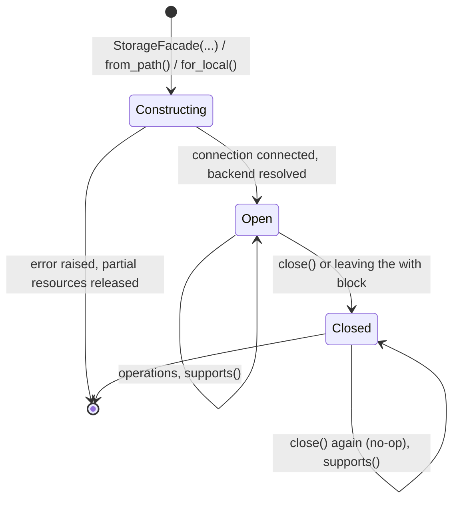

# Opening storage with StorageFacade

`StorageFacade` is the object you call for every file operation. You create one for a store, it opens a connection to that store, and its methods read, write, list, copy and delete through whichever backend the store needs. The calls are the same whether the store is a local directory, an S3 bucket, an SFTP server or a web server.

This page assumes you have installed the package with the extras for the stores you use ([Installation](../03-installation/index.md#base-install-and-extras)), know how a path's scheme selects a backend ([Paths and scheme dispatch](../04-paths-and-schemes/index.md#how-a-path-picks-a-backend)) and know how storage profiles describe a store ([Storage profiles](../05-storage-profiles/index.md#what-a-storage-profile-is)). The operations themselves are described in [File operations](../07-file-operations/index.md).

## Creating a facade

<!-- concept:143 -->

A facade is bound to one provider type, such as local, S3 or SFTP, for its whole life. When you construct it, the facade does three things:

1. If you passed a storage profile, it builds a connection from the profile and the auth profile and connects it.
2. It looks up the backend registered for the provider type and hands it the connection.
3. It records a location policy, if you supplied one, so that every later path is checked against it.

After that, each method checks that the backend supports the operation, checks the path against the location policy and then delegates to the backend. The facade itself holds no file data.

The constructor takes these arguments:

| Argument | Meaning |
|---|---|
| `provider_type` | A `CONST_STORAGE_PROVIDER_TYPE` member, for example `LOCAL`, `S3`, `MINIO`, `SFTP` or `HTTP`. Usually inferred for you by `from_path()`. |
| `storage_profile` | Where the store is: bucket, endpoint, host, root path and transport settings. `None` for the local filesystem. |
| `auth_profile` | Credentials from `mountainash-auth-client`, paired with the storage profile when the connection is built. |
| `oauth_provider`, `token_store` | The managed OAuth2 flow for HTTP stores. The token store stays owned by the caller. |
| `policy` | A `LocationPolicy` that limits which paths and hosts the facade may reach. |

All arguments after `storage_profile` are keyword-only. Profiles never carry secrets: credentials always arrive through `auth_profile`, and `mountainash-auth-client` owns how they are represented and refreshed (see [Credentials come from auth-client](../02-mountainash-ecosystem/index.md#credentials-come-from-auth-client)). The location policy is described in [Location policy](../08-location-policy/index.md#policy-on-the-facade).

The example below defines one function and runs it against a temporary local directory and an S3 bucket. Only the path and the profile change. `ENDPOINT` is the URL of a local S3-compatible server that already has a bucket named `reports`; the examples on these pages use moto's server, and MinIO behaves the same way. For AWS itself you would use `FLAVOR="aws"` with a `REGION` and no endpoint.

```python
import tempfile
from pathlib import Path

from mountainash_auth_client import IAMAuthProfile
from mountainash_transport import StorageFacade
from mountainash_transport.settings.storage.profiles.s3_storage_profile import S3StorageProfile

SALES = b"region,total\nnorth,120\nsouth,95\n"


def round_trip(path: str, profile=None, auth=None) -> None:
    with StorageFacade.from_path(path, profile, auth_profile=auth) as storage:
        storage.write(path, SALES)
        entry = storage.metadata(path)
        assert storage.read(path) == SALES
        print(f"{entry.source}: {entry.name}, {entry.size} bytes")


with tempfile.TemporaryDirectory() as root:
    round_trip(str(Path(root) / "sales.csv"))

profile = S3StorageProfile(FLAVOR="minio", ENDPOINT_URL=ENDPOINT, BUCKET="reports")
auth = IAMAuthProfile(ACCESS_KEY_ID="example-access-key", SECRET_ACCESS_KEY="example-secret")
round_trip("s3://reports/2026/sales.csv", profile, auth)
```

Output:

```text
local: sales.csv, 32 bytes
s3: sales.csv, 32 bytes
```

The facade passes paths to the backend as you wrote them. An S3 facade takes full `s3://bucket/key` paths, and a local facade takes ordinary filesystem paths. A facade is not tied to the path you created it from: one S3 facade can read and write any key its profile and credentials allow.

The facade is defined in `src/mountainash_transport/storage/facade/facade.py`. How it finds the backend class is described in [How the facade dispatches](../13-architecture/index.md#how-the-facade-dispatches).

<!-- concept:144 -->

### `from_path()`

`StorageFacade.from_path(path, storage_profile=None, *, auth_profile=None, oauth_provider=None, token_store=None, policy=None)` reads the scheme of `path`, maps it to a provider type and calls the constructor with the remaining arguments. A bare path or `file://` selects the local backend, `s3://` and the other S3-family schemes select the S3 backend, `sftp://` selects SFTP, and `http://` or `https://` select HTTP.

Two failures can happen before any connection is made. A scheme the package does not recognise raises `ValueError`. A recognised scheme whose provider has a profile but no backend, such as `gs://` or `ftp://`, raises `BackendNotImplementedError` (see [Specs, the registry and settings-only providers](../05-storage-profiles/index.md#specs-the-registry-and-settings-only-providers)). If you pass an active location policy, `from_path()` also rejects schemes the policy does not know before it constructs anything.

<!-- concept:145 -->

### `for_local()`

`StorageFacade.for_local(*, policy=None)` returns a facade on the local filesystem with no storage profile. Use it when the code only ever touches local paths and you do not want to derive the provider from a path. Without a profile there is no connection to open, so construction cannot fail on the network. Pass a `LocationPolicy` to confine the facade to a directory tree; a local storage profile with a `ROOT_PATH` does the same through the constructor (see [Confining local paths](../08-location-policy/index.md#confining-local-paths)).

<!-- concept:117 -->

### The `storage()` factory

The package root also exports a function, `storage(provider_type=CONST_STORAGE_PROVIDER_TYPE.LOCAL, profile=None, *, auth_profile=None)`. It constructs a `StorageFacade` directly from a provider type, defaulting to local. It does not accept a location policy or the OAuth arguments; use the constructor or `from_path()` when you need those. Calling it imports the facade module on demand, in line with the package's lazy root ([Installation](../03-installation/index.md#base-install-and-extras)).

```python
from mountainash_transport import (
    BackendNotImplementedError, CONST_STORAGE_PROVIDER_TYPE, StorageFacade, storage,
)

with StorageFacade.for_local() as local, storage() as same:
    print(type(local).__name__, type(same).__name__)

with storage(CONST_STORAGE_PROVIDER_TYPE.HTTP) as web:
    print("http facade ready")

try:
    StorageFacade.from_path("gs://reports/sales.csv")
except BackendNotImplementedError as error:
    print(f"gs: {type(error).__name__}")

try:
    StorageFacade.from_path("foo://reports/sales.csv")
except ValueError as error:
    print(f"foo: {error}")
```

Output:

```text
StorageFacade StorageFacade
http facade ready
gs: BackendNotImplementedError
foo: Unrecognised scheme in path 'foo://reports/sales.csv'
```

An HTTP facade without a profile gets a default HTTP profile, so it opens a connection even though you passed nothing.

## Capabilities and supports()

<!-- concept:196 -->

Not every store can do everything. An object store has no directories, a plain web server cannot list or delete, and SFTP has no server-side copy. The package describes each capability as a small protocol class, and each backend implements only the protocols that make sense for it. The facade's methods map onto these protocols:

| Protocol | Facade methods | Local | S3 family | SFTP | HTTP |
|---|---|---|---|---|---|
| `StorageReadProtocol` | `read`, `read_stream` | yes | yes | yes | yes |
| `StorageWriteProtocol` | `write`, `write_stream` | yes | yes | yes | yes |
| `StorageEnumerateProtocol` | `list_objects` | yes | yes | yes | no |
| `StorageDeleteProtocol` | `delete` | yes | yes | yes | no |
| `StorageMetadataProtocol` | `exists`, `metadata`, `get_size` | yes | yes | yes | yes |
| `StorageCopyProtocol` | `copy` | yes | yes | no | no |
| `StorageDirectoryProtocol` | `list_dir`, `mkdir`, `rmdir` | yes | no | yes | no |
| `RangedReadProtocol` | `read_stream(access="random")` | native handle | yes | yes | yes |

All eight protocols are exported from the package root. They are `typing.Protocol` classes marked `runtime_checkable`, so a backend satisfies one simply by having the right methods; it does not need to inherit from it. The local backend has no ranged-read method, yet `read_stream(access="random")` still works on local paths because the facade returns the operating system's own seekable file handle instead (see [Read access modes](../09-read-access-modes/index.md#choosing-an-access-mode)).

Settings-only providers (GCS, Azure, FTP, SMB and GitHub) have no backend, so they support none of these protocols; constructing a facade for them fails before any capability question arises.

The complete matrix, including per-backend behaviour that differs inside a supported operation, is kept in the [support matrix and known limits](../../reference/support-matrix.md). The protocol definitions and their method signatures are described in [The storage protocols](../13-architecture/index.md#the-storage-protocols).

<!-- concept:147 -->

### Checking before you call

`facade.supports(protocol)` returns `True` when the facade's backend implements `protocol`. Calling an operation the backend lacks raises `UnsupportedOperationError` (a `StorageError`) before any I/O, naming the backend and the operation. Check with `supports()` when your code accepts any store and has a fallback; let the exception propagate when the operation is essential. The example reuses `profile` and `auth` from the first example on this page.

```python
from mountainash_transport import (
    RangedReadProtocol, StorageCopyProtocol, StorageDeleteProtocol,
    StorageDirectoryProtocol, StorageEnumerateProtocol, StorageFacade,
    StorageMetadataProtocol, StorageReadProtocol, StorageWriteProtocol,
    UnsupportedOperationError,
)

PROTOCOLS = {
    "read": StorageReadProtocol, "write": StorageWriteProtocol,
    "enumerate": StorageEnumerateProtocol, "delete": StorageDeleteProtocol,
    "metadata": StorageMetadataProtocol, "copy": StorageCopyProtocol,
    "directory": StorageDirectoryProtocol, "ranged": RangedReadProtocol,
}

with (
    StorageFacade.for_local() as local,
    StorageFacade.from_path("s3://reports/", profile, auth_profile=auth) as s3,
    StorageFacade.from_path("https://files.example.com/") as web,
):
    for name, facade in (("local", local), ("s3", s3), ("https", web)):
        missing = [cap for cap, proto in PROTOCOLS.items() if not facade.supports(proto)]
        print(f"{name}: missing {', '.join(missing) or 'nothing'}")

    if s3.supports(StorageDirectoryProtocol):
        s3.mkdir("s3://reports/2026")
    try:
        s3.list_dir("s3://reports/")
    except UnsupportedOperationError as error:
        print(error)
```

Output:

```text
local: missing ranged
s3: missing directory
https: missing enumerate, delete, copy, directory
S3StorageBackend does not support 'list_dir'
```

`supports()` checks that the methods exist, not how they behave. Two backends that both support an operation can still differ in detail, for example in how `rmdir` treats a non-empty directory; [File operations](../07-file-operations/index.md) notes each difference where it applies. `supports()` keeps working after the facade is closed.

## Opening and closing

<!-- concept:179 -->

Behind every facade with a profile sits a connection: an object that owns one native client and knows how to open and release it. All connections follow `ConnectionProtocol`, exported from the package root. It is generic in the client type it wraps and defines:

| Member | Behaviour |
|---|---|
| `connect()` | Acquires the native client and returns the connection itself. Calling it again on an open connection releases the old client before creating a new one. |
| `disconnect()` | Releases everything the connection owns, including anything half-acquired by a failed `connect()`. Calling it again is a no-op, even after a failure. |
| `client` | The native client (for example a boto3 S3 client, a paramiko SFTP client or an httpx client), or `None` when disconnected. |
| `is_connected` | Whether a client is currently held. |
| `__enter__` / `__exit__` | Context manager support. Leaving the block disconnects. If the block raised and cleanup also fails, the block's exception stays primary. |

Entering the context does not connect. Call `connect()` yourself, which returns the connection, so `with connection.connect() as conn:` opens and later releases it.

Connections come in two shapes. Leaf connections own one client directly: HTTP, S3, SSH, and a null connection for the local filesystem. Decorator connections wrap another connection and own it exclusively: SFTP runs over an SSH connection, and a tunnelled connection runs any connection through an SSH bastion. Closing a decorator closes what it wraps. These are described in [Leaf connections](../11-connections/index.md#leaf-connections) and [Decorator connections](../11-connections/index.md#decorator-connections).

You rarely build a connection yourself, because the facade calls `create_connection(storage_profile, auth_profile)` and connects the result. You can call it directly when you need the native client, for example to use an SDK feature the facade does not expose. The profile and auth profile are the ones from the first example.

```python
from mountainash_transport import ConnectionProtocol, create_connection

connection = create_connection(profile, auth)
print(isinstance(connection, ConnectionProtocol), connection.is_connected)

with connection.connect() as conn:
    print(conn.is_connected, type(conn.client).__name__)
    buckets = conn.client.list_buckets()["Buckets"]
    print([bucket["Name"] for bucket in buckets])

print(connection.is_connected, connection.client)
connection.disconnect()  # repeated disconnect is a no-op
```

Output:

```text
True False
True S3
['reports']
False None
```

`create_connection` validates that the auth profile suits the storage profile before it builds anything (see [create_connection](../11-connections/index.md#create_connection)). The protocol is defined in `src/mountainash_transport/_core/protocols.py`.

<!-- concept:146 -->

### Facade lifecycle

A facade owns the connection it created. Use it as a context manager, or call `close()` yourself. The lifecycle has three states:



The rules that follow from it:

- Construction either finishes or releases whatever it had acquired before raising. If that cleanup also fails, the details are attached to the original exception as notes.
- Close is terminal. After it, every storage operation and re-entering the `with` block raise `StorageConnectionError`. A facade cannot be reopened; create a new one.
- Repeated `close()` is a no-op, including after a close that failed.
- Streams returned by `read_stream()` belong to you. Close sequential and random streams from a remote store before you close their facade. Closing a stream never closes the facade.
- Buffered results (`access="buffered"`) and the bytes returned by `read()` are independent of the facade and stay usable after it closes.
- `copy_between()` borrows two open facades and never closes them ([Copying between backends](../10-stream-transforms/index.md#copying-between-backends)).

```python
from mountainash_transport import StorageConnectionError, StorageFacade, StorageReadProtocol

path = "s3://reports/2026/sales.csv"
with StorageFacade.from_path(path, profile, auth_profile=auth) as storage:
    storage.write(path, b"region,total\nnorth,120\n")
    with storage.read_stream(path) as stream:   # close remote streams first
        header = stream.readline()
    buffered = storage.read_stream(path, access="buffered")

print(header, buffered.read())              # buffered bytes outlive the facade
print(storage.supports(StorageReadProtocol))
storage.close()                              # repeated close is a no-op
try:
    storage.read(path)
except StorageConnectionError as error:
    print(f"{type(error).__name__}: {error}")
try:
    with storage:
        pass
except StorageConnectionError as error:
    print(f"re-entry: {error}")
```

Output:

```text
b'region,total\n' b'region,total\nnorth,120\n'
True
StorageConnectionError: StorageFacade is closed
re-entry: StorageFacade is closed
```

The package does not promise cleanup by garbage collection. A facade you never close keeps its connection until the process releases it.
