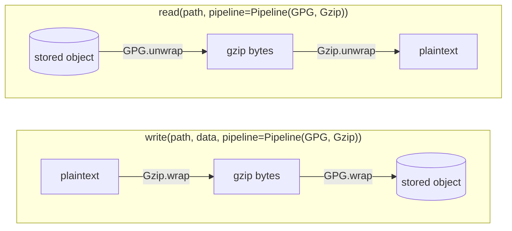

# Stream transforms and cross-backend copy

A stream transform is a reversible encoding, such as gzip compression or GPG encryption, applied to bytes as they move between your code and a store. `StorageFacade.read`, `read_stream`, `write` and `write_stream` accept a `pipeline=` argument, and `copy_between` accepts one for each side of a copy, so you can compress, decompress, encrypt and decrypt on any backend without staging files on disk. Transforms work on bytes only; parsing CSV, Parquet or any other format stays with the consumer (see [formats belong to consumers](../02-mountainash-ecosystem/index.md#formats-belong-to-consumers)).

This page assumes you can open a facade and read and write files ([File operations](../07-file-operations/index.md#reading-and-writing)) and know the three read access modes ([Read access modes](../09-read-access-modes/index.md#choosing-an-access-mode)).

## Transforms and pipelines

<!-- concept:170 -->

### The StreamTransform protocol

`StreamTransform` is a runtime-checkable protocol with two methods. Both take a readable binary stream and return a new readable binary stream:

| Method | Direction | Meaning |
|---|---|---|
| `wrap(stream)` | encode | plaintext in, encoded bytes out (adds a layer) |
| `unwrap(stream)` | decode | encoded bytes in, plaintext out (removes a layer) |

Both directions return something you *read from*. On the write path the facade reads the encoded bytes out of `wrap()` and hands them to the backend, so a transform never needs a writable sink. The protocol asks implementations to stream lazily rather than drain the input when constructed. `Gzip` does this; `GPG` cannot, because its underlying library is not streaming (see [Gzip and GPG](#gzip-and-gpg)).

The package ships two implementations, `Gzip` and `GPG`, both exported from `mountainash_transport`. Any object with matching `wrap` and `unwrap` methods satisfies the protocol, so you can write your own transform and pass it wherever a pipeline is accepted. The protocol lives in `src/mountainash_transport/_core/transforms/base.py`.

<!-- concept:171 -->

### Pipelines

A `Pipeline` is an ordered stack of transforms describing how the bytes are layered in storage. You list transforms **outermost first**: the order in which a reader would peel them off the stored bytes, which is also the order of the file suffixes read from right to left. A file named `sales.csv.gz.gpg` was gzipped first and encrypted second, so GPG is the outer layer:

```python
Pipeline(GPG(...), Gzip())   # stored as gpg-of(gzip-of(plaintext))
```

Every facade method that takes `pipeline=` also accepts a single transform, which it treats as a one-element pipeline, or `None` for no transform. The same pipeline instance serves reads, writes and copies.

A worked round trip with one gzip layer on local disk:

```python
import tempfile
from pathlib import Path

from mountainash_transport import Gzip, Pipeline, StorageFacade

SALES = b"region,total\nnorth,120\nsouth,95\n"

with tempfile.TemporaryDirectory() as root, StorageFacade.for_local() as storage:
    path = str(Path(root) / "sales.csv.gz")
    pipeline = Pipeline(Gzip())

    storage.write(path, SALES, pipeline=pipeline)   # wrap: plaintext -> gzip
    stored = storage.read(path)                     # no pipeline: stored bytes
    decoded = storage.read(path, pipeline=pipeline) # unwrap: gzip -> plaintext

    print(stored[:2].hex(), len(stored))
    print(decoded == SALES)
```

Output:

```text
1f8b 50
True
```

The stored object starts with the gzip magic bytes `1f8b`. Reading without a pipeline returns those stored bytes unchanged; reading with the same pipeline returns the original plaintext.

<!-- concept:172 -->

### Direction

You never reverse a pipeline yourself. The facade applies it in the correct direction for the operation:

- **Read** unwraps from outer to inner, in list order.
- **Write** wraps from inner to outer, in reverse list order.



Because the list describes the stored layout rather than a sequence of steps, one pipeline value is correct for both directions and for both sides of a copy.

## Gzip and GPG

<!-- concept:173 -->

### Gzip

`Gzip` uses only the standard library, so it works on a base install. Its constructor takes three arguments:

| Argument | Default | Effect |
|---|---|---|
| `level` | `6` | Compression level 1 to 9. |
| `mtime` | `0` | Timestamp written into the gzip header. The fixed default makes output byte-identical for identical input; `None` uses the current time. |
| `max_decompressed_bytes` | 1 GiB | Upper bound on decoded bytes when unwrapping. Reading or seeking past it raises `TransformError` before the excess is allocated. `None` removes the bound for trusted data. |

`wrap()` compresses lazily as the result is read (see [Internals: the streaming gzip encoder](#internals-the-streaming-gzip-encoder)). `unwrap()` decodes lazily too, so a malformed `.gz` file opens without error and raises when you read it. If the underlying stream is not seekable, the decoded stream is forward-only. Decompression bounds and read-time errors are shown under [Limits and ownership](#limits-and-ownership).

<!-- concept:174 -->

### GPG

`GPG` encrypts on `wrap()` and decrypts on `unwrap()` through `python-gnupg`, which needs the `[encryption]` extra and a `gpg` binary. Its arguments are `recipients` (required for encryption only), `gnupghome` (keyring directory; `None` uses gpg's default), `key_file` (a key to import on first use), `passphrase` (for a protected private key), `armor` (ASCII output, default `False`) and `always_trust` (skip gpg's owner-trust check when encrypting). Key material lives in the gpg keyring you point it at; transport does not manage keys.

The example below uses a throwaway keyring holding one unprotected key for `reports@example.com`. Creating that keyring is not shown.

```python
import tempfile
from pathlib import Path

from _gpgkey import throwaway_keyring  # scaffolding: temp GNUPGHOME + key
from mountainash_transport import GPG, Gzip, Pipeline, StorageFacade

SALES = b"region,total\nnorth,120\nsouth,95\n"
home = throwaway_keyring()

gpg = GPG(recipients=["reports@example.com"], gnupghome=home, always_trust=True)
pipeline = Pipeline(gpg, Gzip())  # stored as gpg-of(gzip-of(plaintext))

with tempfile.TemporaryDirectory() as root, StorageFacade.for_local() as storage:
    path = str(Path(root) / "sales.csv.gz.gpg")
    storage.write(path, SALES, pipeline=pipeline)

    print(storage.read(path)[:1].hex())   # first byte of an OpenPGP packet
    print(storage.read(path, pipeline=pipeline) == SALES)
```

Output:

```text
85
True
```

`python-gnupg` does not stream, so `GPG` buffers the whole encrypted or decrypted payload in memory on both paths, and decryption failures surface when the stream is opened rather than when it is read. Unlike `Gzip`, it has no bound on decrypted size. A failed encryption or decryption raises `TransformError` carrying gpg's status; calling `wrap()` without recipients raises `TransformError` too. The passphrase you pass is kept as an attribute of the `GPG` instance for its lifetime.

!!! note "Missing `[encryption]` extra"
    Without `python-gnupg` installed, the first `GPG` operation raises a plain `ImportError` naming the `[encryption]` extra, not `MissingExtraError`. See the [support matrix and known limits](../../reference/support-matrix.md#known-limits).

## Suffix inference

<!-- concept:175 -->

Reads can derive the pipeline from the path instead of taking it explicitly. `infer_pipeline(path, gpg=..., gzip=...)` walks the file's suffix chain (see [StoragePath](../04-paths-and-schemes/index.md#storagepath)) from right to left and stops at the first suffix it does not recognise. `.gz` and `.gzip` map to `Gzip`; `.gpg`, `.asc` and `.pgp` map to `GPG`. Matching ignores case. It returns `(pipeline, stripped_path)`, with `pipeline` set to `None` when no known suffix was found. A GPG suffix requires a `gpg=` instance because key material is never guessed; `gzip=` optionally overrides the default `Gzip()`.

On the facade, `read(..., infer=True)` and `read_stream(..., infer=True)` call the same function and take the same `gpg=` and `gzip=` arguments. Passing both `infer=True` and `pipeline=` raises `ValueError`. Writes have no `infer` option: pass the pipeline explicitly when writing.

```python
import tempfile
from pathlib import Path

from _gpgkey import throwaway_keyring  # scaffolding: temp GNUPGHOME + key
from mountainash_transport import GPG, StorageFacade, infer_pipeline

for name in ("sales.csv.gz", "sales.CSV.GZ", "sales.csv", "sales.csv.gz.bak"):
    pipeline, stripped = infer_pipeline(name)
    print(f"{name:18} pipeline={pipeline is not None}  stripped={stripped}")

try:
    infer_pipeline("sales.csv.gz.gpg")
except ValueError as exc:
    print(exc)

gpg = GPG(recipients=["reports@example.com"], gnupghome=throwaway_keyring(),
          always_trust=True)
pipeline, stripped = infer_pipeline("sales.csv.gz.gpg", gpg=gpg)

with tempfile.TemporaryDirectory() as root, StorageFacade.for_local() as storage:
    path = str(Path(root) / "sales.csv.gz.gpg")
    storage.write(path, b"region,total\nnorth,120\n", pipeline=pipeline)
    print(storage.read(path, infer=True, gpg=gpg))
```

Output:

```text
sales.csv.gz       pipeline=True  stripped=sales.csv
sales.CSV.GZ       pipeline=True  stripped=sales.CSV
sales.csv          pipeline=False  stripped=sales.csv
sales.csv.gz.bak   pipeline=False  stripped=sales.csv.gz.bak
path 'sales.csv.gz.gpg' has a .gpg suffix; pass gpg=GPG(...) to infer
b'region,total\nnorth,120\n'
```

`sales.csv.gz.bak` infers nothing because `.bak` is unknown and parsing stops there. Because writes do not infer, the example writes with the pipeline that `infer_pipeline` returned for the target name, then lets `read` infer the same layers. The suffix table is `SUFFIX_TRANSFORMS` in `src/mountainash_transport/storage/path_helpers/suffixes.py`.

## Limits and ownership

<!-- concept:176 -->

### Transforms and random access

`access="random"` fetches byte ranges of the *stored* object (see [Random access](../09-read-access-modes/index.md#choosing-an-access-mode)). A compressed or encrypted object has no meaningful offsets in its plaintext, so the facade refuses the combination, whether the pipeline is explicit or inferred. Use `access="sequential"` (the default) to decode while streaming, or `access="buffered"` when the consumer needs to seek in the decoded bytes.

```python
import tempfile
from pathlib import Path

from mountainash_transport import Gzip, StorageFacade, TransformError

with tempfile.TemporaryDirectory() as root, StorageFacade.for_local() as storage:
    path = str(Path(root) / "events.log.gz")
    storage.write(path, b"event\n" * 10_000, pipeline=Gzip())

    try:
        storage.read_stream(path, infer=True, access="random")
    except ValueError as exc:
        print("random:", exc)

    try:
        storage.read(path, pipeline=Gzip(max_decompressed_bytes=1024))
    except TransformError as exc:
        print("bound:", exc)
```

Output:

```text
random: access='random' cannot be combined with transforms
bound: gzip: decompressed size exceeds max_decompressed_bytes=1024; pass Gzip(max_decompressed_bytes=...) to raise it for trusted data
```

The second call shows the gzip decompression bound: the payload decodes to 60,000 bytes, more than the 1,024 allowed.

<!-- concept:178 -->

### Who closes what

The read path follows the ownership rules in [Errors and ownership](../09-read-access-modes/index.md#errors-and-ownership): the stream returned by `read_stream` owns every transform layer the facade built plus the backend stream, and closing it closes them in reverse construction order. If you call `Pipeline.apply_read(source)` or `unwrap()` yourself, the stream you supplied stays yours: transforms leave borrowed inputs open, and you close the source separately.

The gzip write path does not follow that rule. The compressing reader returned by `Gzip.wrap()` closes its source when it is closed or garbage-collected, so after `write_stream(..., pipeline=Gzip())` returns, the stream you passed in is closed:

```python
import io
import tempfile
from pathlib import Path

from mountainash_transport import Gzip, StorageFacade

with tempfile.TemporaryDirectory() as root, StorageFacade.for_local() as storage:
    path = str(Path(root) / "events.log.gz")

    source = io.BytesIO(b"event\n" * 100)
    storage.write_stream(path, source, pipeline=Gzip())
    print("gzip write, caller stream closed:", source.closed)

    plain = io.BytesIO(b"event\n" * 100)
    storage.write_stream(str(Path(root) / "events.log"), plain)
    print("plain write, caller stream closed:", plain.closed)

    with open(path, "rb") as handle:          # a stream you own
        decoded = Gzip().unwrap(handle)
        decoded.read()
        decoded.close()
        print("unwrap, caller stream closed:", handle.closed)
```

Output:

```text
gzip write, caller stream closed: True
plain write, caller stream closed: False
unwrap, caller stream closed: False
```

!!! warning "Gzip writes close the caller's stream"
    Writing through a `Gzip` layer (`write_stream`, `copy_between` with a gzip `destination_pipeline`, or `Gzip.wrap()` directly) closes the source stream you supplied. Do not reuse that stream afterwards; if you need it, pass a separate handle. See the [support matrix and known limits](../../reference/support-matrix.md#known-limits).

## Copying between backends

<!-- concept:157 -->

`copy_between(source_path, destination_path, source_facade, destination_facade, *, source_pipeline=None, destination_pipeline=None)` copies one file between two open facades, which may use different backends. `source_pipeline` decodes what is read; `destination_pipeline` encodes what is written. Use them to recompress, encrypt or decrypt during the copy. Both facades are borrowed: they must already be open, and `copy_between` never closes them.

The function streams the source's `read_stream` into the destination's `write_stream`. It uses the backend's native copy instead ([Copying](../07-file-operations/index.md#copying)) only when no pipeline is given, both facades use the same backend class and equal location policies, they share the *identical* storage profile object (compared with `is`, not equality), and the backend supports copy. Two facades built from separate but equal profiles therefore stream the bytes through your process.

This example copies a local file to an S3 bucket, compressing on the way. It ran against an in-process S3 endpoint; the endpoint setup is not shown. The `IAMAuthProfile` comes from `mountainash-auth-client` (see [credentials come from auth-client](../02-mountainash-ecosystem/index.md#credentials-come-from-auth-client)).

```python
import tempfile
from pathlib import Path

from mountainash_auth_client import IAMAuthProfile
from mountainash_transport import Gzip, StorageFacade, copy_between
from mountainash_transport.settings.storage.profiles.s3_storage_profile import S3StorageProfile

SALES = b"region,total\nnorth,120\nsouth,95\n"

profile = S3StorageProfile(FLAVOR="aws", REGION="ap-southeast-2", BUCKET="reports")
keys = IAMAuthProfile(ACCESS_KEY_ID="example-access-key", SECRET_ACCESS_KEY="example-secret")

with tempfile.TemporaryDirectory() as root:
    local_path = str(Path(root) / "sales.csv")
    remote_path = "s3://reports/archive/sales.csv.gz"
    with (
        StorageFacade.for_local() as local,
        StorageFacade.from_path(remote_path, profile, auth_profile=keys) as s3,
    ):
        local.write(local_path, SALES)
        copy_between(local_path, remote_path, local, s3,
                     destination_pipeline=Gzip())

        print(s3.get_size(remote_path), "bytes stored")
        print(s3.read(remote_path, infer=True) == SALES)
```

Output:

```text
50 bytes stored
True
```

A failure part-way through can leave a partial destination object; `copy_between` does no cleanup or atomic rename. The destination backend decides how the stream is written.

!!! note "SFTP destinations buffer the payload"
    An SFTP backend reads the whole incoming stream into memory before writing it, so a streamed copy to SFTP holds the full payload in memory. See [Where backends differ](../14-backends/index.md#where-backends-differ) and the [support matrix and known limits](../../reference/support-matrix.md#known-limits).

The function is defined in `src/mountainash_transport/storage/facade/cross_backend.py`.

## Internals: the streaming gzip encoder

<!-- concept:177 -->

`Gzip.wrap()` returns a `GzipCompressingReader` from the private module `src/mountainash_transport/_core/transforms/_stream_encoder.py`. It is a read-side adapter: each time it is read, it pulls the next 64 KiB chunk from the source, feeds it to a raw deflate compressor, and hands out compressed bytes. It writes a minimal RFC 1952 header first and appends the CRC32 and size trailer once the source is exhausted. Constructing it reads nothing, which is what lets the write path stream an arbitrarily large source into a backend without holding it in memory. The fixed header `mtime` (default `0`) makes output reproducible.

The behaviour is observable through the public `Gzip` class:

```python
import gzip
import io

from mountainash_transport import Gzip


class CountingStream(io.BytesIO):
    """A source that records how many bytes the encoder has pulled."""
    pulled = 0

    def read(self, size=-1):
        chunk = super().read(size)
        self.pulled += len(chunk)
        return chunk


payload = b"event\n" * 50_000                      # 300,000 bytes
source = CountingStream(payload)
encoded = Gzip().wrap(source)
print("after wrap:", source.pulled)

first = encoded.read(10)
print("after reading 10 bytes:", source.pulled)

rest = encoded.read()
print("after draining:", source.pulled)
print(gzip.decompress(first + rest) == payload)
print(Gzip().wrap(io.BytesIO(payload)).read() == (first + rest))
```

Output:

```text
after wrap: 0
after reading 10 bytes: 65536
after draining: 300000
True
True
```

The adapter's `close()` closes its source, which is the cause of the write-path ownership difference described in [Who closes what](#who-closes-what). It has no direct unit tests; `tests/_core/transforms/test_gzip.py` covers it through `Gzip` (laziness, reproducibility and round trips). The decoding side, `_BoundedGzipFile` in `compression.py`, caps every read at the configured limit plus one byte, so a hostile payload fails before it allocates more than the limit.
