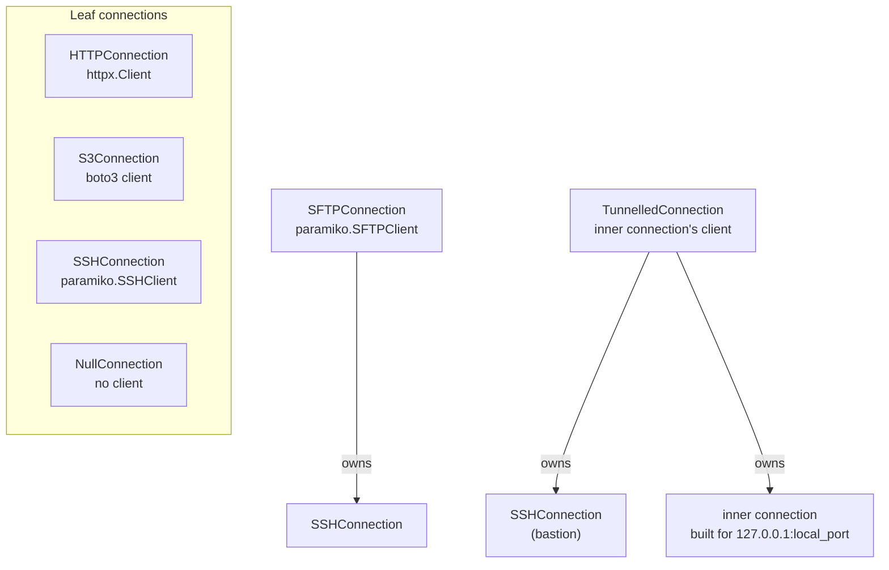

# Connections, SSH and tunnels

A connection turns a storage profile and an auth profile into a live SDK client: an `httpx.Client`, a boto3 S3 client, a paramiko `SSHClient` or `SFTPClient`, or nothing at all for local disk. `StorageFacade` builds and owns one for you. You use connections directly when you want the SDK client itself, when you need a plain SSH session, or when the target is only reachable through an SSH bastion host.

This page assumes the connection lifecycle described in [Opening and closing](../06-storage-facade/index.md#opening-and-closing) and the profiles in [Storage profiles and credentials](../05-storage-profiles/index.md#what-a-storage-profile-is). Connections require the `[http]` extra; the S3 and SSH connections also need the `[s3]` or `[sftp]` extra ([Base install and extras](../03-installation/index.md#base-install-and-extras)).

## create_connection

<!-- concept:180 -->

`create_connection(profile, auth_profile=None)` is the factory for every connection type. It runs in three steps and performs no network I/O:

1. It checks the auth profile's mode (for example `password`, `iam`, `none`) against the profile spec's `supported_auth` set and raises `UnsupportedAuthProfileError` on a mismatch.
2. It picks the connection class from the profile's provider type.
3. It builds the SDK keyword arguments by asking the profile to emit them, then layering the auth profile's credentials on top ([How profiles become SDK arguments](../05-storage-profiles/index.md#how-profiles-become-sdk-arguments)).

The returned connection is not yet connected; call `connect()` or use it as a context manager after connecting. Credentials come from the auth profile, which `mountainash-auth-client` owns (see [credentials come from auth-client](../02-mountainash-ecosystem/index.md#credentials-come-from-auth-client)).

```python
from mountainash_auth_client import IAMAuthProfile, PasswordAuthProfile
from mountainash_transport import create_connection
from mountainash_transport.settings.storage.profiles import (
    FTPStorageProfile, HTTPStorageProfile, LocalStorageProfile, S3StorageProfile,
    SFTPStorageProfile,
)

pairs = [
    (LocalStorageProfile(), None),
    (HTTPStorageProfile(), None),
    (S3StorageProfile(FLAVOR="r2", ACCOUNT_ID="abc123", BUCKET="reports"),
     IAMAuthProfile(ACCESS_KEY_ID="example-access-key", SECRET_ACCESS_KEY="example-secret")),
    (SFTPStorageProfile(HOST="sftp.example.com", USERNAME="analyst"),
     PasswordAuthProfile(USERNAME="analyst", PASSWORD="example-password")),
    (FTPStorageProfile(HOST="ftp.example.com"), None),
]
for profile, auth in pairs:
    connection = create_connection(profile, auth)        # no network I/O yet
    print(f"{type(profile).__name__:20} -> {type(connection).__name__}"
          f" (connected={connection.is_connected})")

with create_connection(HTTPStorageProfile()).connect() as http:
    print(type(http.client).__name__, http.client.timeout.read)
```

Output:

```text
LocalStorageProfile  -> NullConnection (connected=True)
HTTPStorageProfile   -> HTTPConnection (connected=False)
S3StorageProfile     -> S3Connection (connected=False)
SFTPStorageProfile   -> SFTPConnection (connected=False)
FTPStorageProfile    -> HTTPConnection (connected=False)
Client 30.0
```

The FTP line shows the factory's fallback. A provider type with no entry in the factory's map, which includes the settings-only providers (GCS, Azure, FTP, SMB, GitHub) and profiles with no provider type, is given an `HTTPConnection`. Construction succeeds; `connect()` then fails because httpx does not accept the FTP profile's arguments (see [Connection errors](#connection-errors)).

!!! note "Fallback to `HTTPConnection`"
    `create_connection` does not reject providers it has no mapping for; it returns an `HTTPConnection` built from that profile's arguments. The error appears at `connect()` as a `TransportConnectionError`, not as `BackendNotImplementedError`. The factory also accepts an `auto_authorize` keyword that currently has no effect. See the [support matrix and known limits](../../reference/support-matrix.md#known-limits).

<!-- concept:181 -->

### Target families

A target family names the SDK a set of keyword arguments is for. The enum, `TargetFamily`, belongs to `mountainash-auth-client`; transport maps each provider to one:

| Provider types | Target family | SDK |
|---|---|---|
| `http` | `HTTP` | httpx |
| `s3`, `s3express`, `r2`, `minio`, `b2` | `BOTO` | boto3 |
| `sftp`, `ssh` | `PARAMIKO` | paramiko |

Both the storage profile and the auth profile emit arguments for the chosen family, so a password renders as `password=` for paramiko and as an `Authorization` header for httpx without either profile knowing about the other. For `BOTO` with a `ROLE_ARN` or `PROFILE_NAME` on the auth profile, the factory instead builds a session envelope that `S3Connection` turns into a boto3 session (see [S3Connection](#s3connection)). The maps live in `src/mountainash_transport/connections/__init__.py`.

## Leaf connections

<!-- concept:182 -->

A leaf connection wraps exactly one SDK client and depends on nothing else. Every connection, leaf or decorator, implements `ConnectionProtocol`:

| Member | Behaviour |
|---|---|
| `connect()` | Creates the SDK client and returns the connection itself. Calling it again closes the old client and creates a new one. |
| `disconnect()` | Releases everything the connection owns, including partially acquired resources after a failed `connect()`. Safe to call repeatedly. |
| `client` | The SDK client, or `None` when disconnected. |
| `is_connected` | Whether `client` is live. |
| `with` block | Leaving the block calls `disconnect()`. Entering does **not** connect. |

The last row matters for direct use: write `with connection.connect() as c:`. If the body raises and cleanup also fails, the body's exception stays primary and the cleanup failure is attached to it as a note.

There are four leaf connections:

| Connection | Created for | `client` | SDK import |
|---|---|---|---|
| `HTTPConnection` | `http`, and unmapped providers | `httpx.Client` | `[http]` extra |
| `S3Connection` | the S3 family | boto3 S3 client | lazy, `[s3]` extra |
| `SSHConnection` | the SSH side of SFTP, and bastions | `paramiko.SSHClient` | lazy, `[sftp]` extra |
| `NullConnection` | `local` | `None` | none |

S3 and SSH import their SDK inside `connect()`, so importing the connection classes works on an install without boto3 or paramiko; the missing SDK is reported only when you connect.

Leaf connections never own other connections, which is what lets decorators (next section) compose them. A facade uses the same objects: `StorageFacade` calls `create_connection`, connects the result, and hands the client to its backend; closing the facade disconnects it ([Opening and closing](../06-storage-facade/index.md#opening-and-closing)).



<!-- concept:184 -->

### HTTPConnection

`HTTPConnection` creates an `httpx.Client` from the emitted arguments. For an `HTTPStorageProfile` those are the timeouts (`TIMEOUT_CONNECT`, `TIMEOUT_READ`, `TIMEOUT_WRITE`), redirect settings, TLS verification and custom headers; the auth profile adds credentials such as a bearer token or basic auth. The profile carries no base URL, so requests use absolute URLs. In the first example, `http.client.timeout.read` is `30.0`, the profile's default `TIMEOUT_READ`.

Creating an `httpx.Client` does no network I/O, so `connect()` succeeds without a server. Network failures appear on the first request. If you want retries, typed errors and token refresh on top of this client, wrap it in the [HTTP request engine](../12-http-engine/index.md#making-requests); the HTTP storage backend does exactly that.

<!-- concept:185 -->

### S3Connection

`S3Connection` creates a boto3 S3 client for any S3 flavour (AWS, S3 Express, R2, MinIO, B2); the flavour has already shaped the emitted region and endpoint ([Provider profiles](../05-storage-profiles/index.md#provider-profiles)). With explicit keys or no credentials it calls `boto3.client("s3", ...)` directly. With a `PROFILE_NAME` on the auth profile it builds a boto3 session from that named AWS profile; with a `ROLE_ARN` it adds refreshable assume-role credentials obtained through AWS STS. Assume-role is limited to the `aws` and `express` flavours; pairing a role with R2, MinIO or B2 raises `ValueError` in `create_connection`. Setting both `PROFILE_NAME` and explicit keys raises `ValueError` at `connect()`.

The example below ran against an in-process S3 endpoint; its setup is not shown.

```python
from mountainash_auth_client import IAMAuthProfile
from mountainash_transport import create_connection
from mountainash_transport.settings.storage.profiles import S3StorageProfile

profile = S3StorageProfile(FLAVOR="aws", REGION="ap-southeast-2", BUCKET="reports")
keys = IAMAuthProfile(ACCESS_KEY_ID="example-access-key", SECRET_ACCESS_KEY="example-secret")

with create_connection(profile, keys).connect() as s3:
    s3.client.put_object(Bucket="reports", Key="sales.csv", Body=b"region,total\n")
    listing = s3.client.list_objects_v2(Bucket="reports")
    print(type(s3).__name__, s3.client.meta.region_name)
    print([item["Key"] for item in listing["Contents"]])
print(s3.is_connected)
```

Output:

```text
S3Connection ap-southeast-2
['sales.csv']
False
```

A missing boto3 raises `TransportConnectionError` naming the `[s3]` extra, not `MissingExtraError` (see the [support matrix and known limits](../../reference/support-matrix.md#known-limits)).

<!-- concept:186 -->

### SSHConnection

`SSHConnection` creates a `paramiko.SSHClient` and connects it. Its constructor takes paramiko `connect()` keyword arguments (`hostname`, `port`, `username`, `password`, `pkey`, `timeout` and so on); `create_connection` produces them from an `SFTPStorageProfile`, and you can also pass them yourself. One extra key, `_post_connect`, carries settings applied to the client rather than to `connect()`: `known_hosts_file` and `host_key_policy`. The profile fields `KNOWN_HOSTS_FILE` and `HOST_KEY_POLICY` emit into it.

Host keys are checked against the system known-hosts files plus `known_hosts_file`. An unknown host is handled by the policy: `reject` (the default) refuses it, `warn` logs and connects, `auto_add` trusts it for the life of the client. `warn` and `auto_add` allow a man-in-the-middle, so keep them to trusted networks.

The example ran against an in-process SSH server; starting it is not shown. `server.write_known_hosts` is that test server's helper for recording its own key in a known-hosts file.

```python
from mountainash_transport import SSHConnection, TransportConnectionError

kwargs = {
    "hostname": "127.0.0.1", "port": server.port,
    "username": "analyst", "password": "example-password",
    "allow_agent": False, "look_for_keys": False,
}

try:
    SSHConnection(kwargs).connect()              # default policy: reject unknown keys
except TransportConnectionError as exc:
    print(exc)

server.write_known_hosts(known_hosts)            # trust the server's key
trusted = {**kwargs, "_post_connect": {"known_hosts_file": known_hosts}}
with SSHConnection(trusted).connect() as ssh:
    print(type(ssh.client).__name__, ssh.client.get_transport().is_active())
```

Output (the port differs on each run):

```text
SSH connection failed: Server '[127.0.0.1]:46735' not found in known_hosts
SSHClient True
```

Timeouts raise `ConnectionTimeoutError`; DNS, socket, authentication and host-key failures raise `TransportConnectionError`. A missing paramiko also raises `TransportConnectionError`, naming the `[sftp]` extra.

<!-- concept:188 -->

### NullConnection

`NullConnection` is the connection for local storage. It has no client (`client` is `None`), `is_connected` is always `True`, and `connect()` and `disconnect()` do nothing. It exists so that the facade and other code can treat every backend through `ConnectionProtocol` without special-casing local disk: `create_connection(LocalStorageProfile())` returns one, as the first example shows, and a facade's open and close sequence runs unchanged over it. You rarely construct it yourself; use it as a stand-in wherever a `ConnectionProtocol` is required and no remote client is involved.

## Decorator connections

<!-- concept:183 -->

A decorator connection wraps another connection and adds a layer on top of it: a protocol channel, or a network path. Its `connect()` connects the inner connection first if needed, then builds its own layer; `disconnect()` tears its layer down and then disconnects the inner connection. Decorators own their children exclusively, so do not share an inner connection between two decorators, or use it separately: disconnecting the decorator closes it. Failures during `connect()` release everything acquired so far before the original error propagates, with any cleanup failure attached as a note.

There are two decorators: `SFTPConnection` (SFTP over SSH) and `TunnelledConnection` (any connection through an SSH bastion). Both are shown in the diagram under [Leaf connections](#leaf-connections).

<!-- concept:187 -->

### SFTPConnection

`SFTPConnection` opens an SFTP channel over an `SSHConnection` it owns, and its `client` is a `paramiko.SFTPClient`. `create_connection` returns one for any SFTP profile. Reconnecting replaces the channel but reuses a still-connected SSH session. The example ran against an in-process SSH server with an SFTP subsystem; its setup, including the known-hosts file and the remote directory, is not shown.

```python
from mountainash_auth_client import PasswordAuthProfile
from mountainash_transport import create_connection
from mountainash_transport.settings.storage.profiles import SFTPStorageProfile

profile = SFTPStorageProfile(
    HOST="127.0.0.1", PORT=server.port, USERNAME="analyst",
    KNOWN_HOSTS_FILE=known_hosts,          # HOST_KEY_POLICY defaults to "reject"
    ALLOW_AGENT=False, LOOK_FOR_KEYS=False,
)
auth = PasswordAuthProfile(USERNAME="analyst", PASSWORD="example-password")

connection = create_connection(profile, auth)
print(type(connection).__name__, connection.is_connected)

with connection.connect() as sftp:
    with sftp.client.open(f"{remote_dir}/hello.txt", "wb") as fh:
        fh.write(b"hello over sftp\n")
    print(sftp.client.listdir(remote_dir))
    print(type(sftp.client).__name__)

print(connection.is_connected)
```

Output:

```text
SFTPConnection False
['hello.txt']
SFTPClient
False
```

For file operations on an SFTP server you would normally use `StorageFacade.from_path("sftp://...")`, which drives this same connection ([SFTP](../14-backends/index.md#sftp)).

<!-- concept:189 -->

### Bastion tunnels

A bastion (jump host) is an SSH server you can reach that can, in turn, reach a private service. `create_tunnelled_connection(bastion_profile, bastion_auth, target_profile, target_auth, remote_host, remote_port)` builds a `TunnelledConnection` for that path. On `connect()` it:

1. connects an `SSHConnection` to the bastion, built from `bastion_profile` (an `SFTPStorageProfile` works) and `bastion_auth`;
2. starts a listener on `127.0.0.1` at an ephemeral port, exposed as `local_port`, that forwards each accepted socket to `remote_host:remote_port` through the bastion;
3. builds the inner connection from `target_profile` and `target_auth` with `create_connection`, after rewriting the target's endpoint to point at the listener, and connects it.

`client` is the inner connection's client. `disconnect()` closes the inner connection, the listener and its sockets, then the SSH session, and waits up to one second for forwarding threads before raising `ConnectionTimeoutError`. `StorageFacade` has no tunnel option, so you use the tunnelled client directly.

The example below reaches a private web service through a bastion. Both the bastion (an in-process SSH server) and the web service (a local `http.server`) ran in the same process; their setup is not shown.

```python
from mountainash_auth_client import PasswordAuthProfile
from mountainash_transport import create_tunnelled_connection
from mountainash_transport.settings.storage.profiles import HTTPStorageProfile, SFTPStorageProfile

bastion_profile = SFTPStorageProfile(
    HOST="127.0.0.1", PORT=bastion.port, USERNAME="analyst",
    KNOWN_HOSTS_FILE=known_hosts, ALLOW_AGENT=False, LOOK_FOR_KEYS=False,
)
bastion_auth = PasswordAuthProfile(USERNAME="analyst", PASSWORD="example-password")

tunnel = create_tunnelled_connection(
    bastion_profile, bastion_auth,
    HTTPStorageProfile(), None,          # what to build on the near end
    service_host, service_port,          # where the bastion forwards to
)
with tunnel.connect():
    url = f"http://127.0.0.1:{tunnel.local_port}/sales.csv"
    response = tunnel.client.get(url)
    print(type(tunnel.client).__name__, response.status_code, response.content)

print("bastion forwarded to:", bastion.forwards == [(service_host, service_port)])
print("connected after exit:", tunnel.is_connected)
```

Output:

```text
Client 200 b'region,total\nnorth,120\n'
bastion forwarded to: True
connected after exit: False
```

#### How the target endpoint is rewritten

The rewrite touches only specific keys in the target's emitted arguments, so what the inner client points at depends on the profile:

| Target profile emits | Rewritten to | Effect |
|---|---|---|
| `hostname` and `port` (SFTP) | `127.0.0.1` and `local_port` | the inner SSH session goes through the tunnel |
| `endpoint_url` or `base_url` (for example an S3 profile with `ENDPOINT_URL`) | `http://127.0.0.1:<local_port>` | through the tunnel, always as plain HTTP |
| neither (an `HTTPStorageProfile`; an `aws` flavour S3 profile) | unchanged | the client is not pointed at the tunnel |

The rewrite is visible on a boto3 client's endpoint. Bastion setup is again not shown:

```python
from mountainash_auth_client import PasswordAuthProfile
from mountainash_transport import create_tunnelled_connection
from mountainash_transport.settings.storage.profiles import S3StorageProfile, SFTPStorageProfile

bastion_profile = SFTPStorageProfile(
    HOST="127.0.0.1", PORT=bastion.port, USERNAME="analyst",
    KNOWN_HOSTS_FILE=known_hosts, ALLOW_AGENT=False, LOOK_FOR_KEYS=False,
)
bastion_auth = PasswordAuthProfile(USERNAME="analyst", PASSWORD="example-password")

targets = {
    "minio": S3StorageProfile(FLAVOR="minio", ENDPOINT_URL="https://minio.internal:9000",
                              BUCKET="reports"),
    "aws": S3StorageProfile(FLAVOR="aws", REGION="ap-southeast-2", BUCKET="reports"),
}
for name, target in targets.items():
    with create_tunnelled_connection(bastion_profile, bastion_auth, target, None,
                                     "minio.internal", 9000) as tunnel:
        tunnel.connect()
        print(f"{name}: {tunnel.client.meta.endpoint_url}")
```

Output (the port differs on each run):

```text
minio: http://127.0.0.1:40731
aws: https://s3.ap-southeast-2.amazonaws.com
```

For an HTTP target, build URLs from `local_port` yourself, as the first tunnel example does.

!!! warning "Some targets bypass the tunnel without an error"
    Through `create_tunnelled_connection`, an `aws` flavour S3 profile (one without `ENDPOINT_URL`) keeps its public AWS endpoint and connects directly to AWS, silently bypassing the bastion. An `HTTPStorageProfile` target does the same unless you build its URLs from `local_port`. Nothing raises in either case. See the [support matrix and known limits](../../reference/support-matrix.md#known-limits).

!!! warning "HTTPS targets do not work through a tunnel"
    The bastion hop is SSH, so traffic between your machine and the bastion is encrypted. The problem is the last leg: a rewritten `endpoint_url` or `base_url` always becomes `http://127.0.0.1:<port>`, dropping the original scheme, host name and any path prefix. An HTTPS-only service then receives plain HTTP on its TLS port and the request fails; Host headers, SNI and certificate checks would no longer name the real service in any case. Tunnel only plain-HTTP or SSH targets. See the [support matrix and known limits](../../reference/support-matrix.md#known-limits).

!!! warning "SFTP through a tunnel and host-key checking"
    An SFTP target's host key is looked up under the rewritten address, `[127.0.0.1]:<local_port>`, and the port changes on every connect. A known-hosts entry for the real target never matches, so the default `reject` policy refuses the connection with `Server '[127.0.0.1]:<port>' not found in known_hosts`. Connecting succeeds only with `HOST_KEY_POLICY="warn"` or `"auto_add"` on the target profile, which do not verify the target's identity.

The listener on `127.0.0.1` has no access control: any local process can use the tunnel while it is open. Unit tests for the tunnel, including the endpoint rewrite and cleanup ordering, are in `tests/connections/test_tunnel_connection.py`; the source is `src/mountainash_transport/connections/tunnel.py`.

## Connection errors

<!-- concept:190 -->

Connection failures raise `TransportConnectionError` (exported from `mountainash_transport`) or a subclass from `mountainash_transport.connections.errors`:

| Exception | Raised when |
|---|---|
| `TransportConnectionError` | Client construction, socket, DNS, SSH authentication or host-key failure; missing boto3 or paramiko; tunnel cleanup failure |
| `ConnectionTimeoutError` | A connect timed out, or tunnel workers did not stop within one second |
| `UnsupportedAuthProfileError` | The auth mode is not in the profile's `supported_auth` (raised by `create_connection` and by named-profile resolution) |
| `TokenExchangeError`, `TokenRefreshError`, `AuthorizationRequired` | Defined for OAuth token failures; transport's own connection code does not raise them, since OAuth flows belong to `mountainash-auth-client` |

The module also exports `ConnectionError` as an alias of `TransportConnectionError`; it shadows Python's built-in `ConnectionError` if you star-import the module. `TransportConnectionError` is separate from the `StorageError` hierarchy ([Errors](../03-installation/index.md#errors)): handlers for storage errors do not catch it.

```python
import socket

from mountainash_auth_client import PasswordAuthProfile
from mountainash_transport import StorageError, TransportConnectionError, create_connection
from mountainash_transport.connections.errors import UnsupportedAuthProfileError
from mountainash_transport.settings.storage.profiles import (
    FTPStorageProfile, HTTPStorageProfile, S3StorageProfile, SFTPStorageProfile,
)

with socket.socket() as probe:                 # find a local port nobody listens on
    probe.bind(("127.0.0.1", 0))
    closed_port = probe.getsockname()[1]

password = PasswordAuthProfile(USERNAME="analyst", PASSWORD="example-password")
attempts = {
    "s3 + password": lambda: create_connection(
        S3StorageProfile(FLAVOR="aws", REGION="ap-southeast-2", BUCKET="reports"), password),
    "ftp (no backend)": lambda: create_connection(
        FTPStorageProfile(HOST="ftp.example.com")).connect(),
    "sftp, port closed": lambda: create_connection(
        SFTPStorageProfile(HOST="127.0.0.1", PORT=closed_port, USERNAME="analyst"),
        password).connect(),
}
for name, attempt in attempts.items():
    try:
        attempt()
    except TransportConnectionError as exc:
        print(f"{name}: {type(exc).__name__}\n    {exc}")

print(issubclass(UnsupportedAuthProfileError, TransportConnectionError))
print(issubclass(TransportConnectionError, StorageError))
```

Output (the port differs on each run):

```text
s3 + password: UnsupportedAuthProfileError
    PasswordAuthProfile is not supported: mode 'password' not in supported_auth ['iam', 'none']
ftp (no backend): TransportConnectionError
    Failed to create HTTP client: Client.__init__() got an unexpected keyword argument 'ftp_class_path'
sftp, port closed: TransportConnectionError
    SSH connection failed: [Errno None] Unable to connect to port 44171 on 127.0.0.1
True
False
```

The first failure happens inside `create_connection`, before any I/O; the other two happen at `connect()`. When you go through `StorageFacade` instead, backend operations translate I/O failures into the `StorageError` family, but errors raised while the facade builds and connects its connection reach you as shown here.
