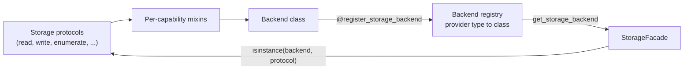

# Architecture: protocols and dispatch

Every storage operation in mountainash-transport passes through three layers. Runtime-checkable protocols define what an operation looks like. Backend classes, composed from one mixin per capability, implement those protocols for one kind of store. A registry maps each provider type to a backend class, and `StorageFacade` looks the class up, instantiates it, and checks the matching protocol before every call. A backend therefore declares its capabilities by its method set alone, and the facade discovers them at runtime.

This page assumes the facade and file operations from [Opening storage with StorageFacade](../06-storage-facade/index.md) and [File operations](../07-file-operations/index.md), plus the access modes in [Read access modes](../09-read-access-modes/index.md#choosing-an-access-mode). It is written for readers who extend the package or need to know why a call succeeds or raises on a given backend.



## Protocols as contracts

<!-- concept:197 -->
A storage protocol is a `typing.Protocol` class decorated with `@runtime_checkable`. It lists method names and signatures and nothing else. A class conforms when it has every listed method; it does not need to inherit from the protocol or register with it. Python's `isinstance()` and `issubclass()` then answer "does this object have these methods?" at runtime.

The check is structural and shallow. It confirms that each named method exists. It does not compare parameter lists, return types or behaviour, so a method with the right name and the wrong keyword arguments still passes. mypy checks signatures where a class is declared against a protocol, and the backend test suites check behaviour (see [Tests that guard the contracts](../15-maintaining/index.md#tests-that-guard-the-contracts)).

A class with only some of a protocol's methods does not conform to it:

```python
import io
from mountainash_transport import (
    StorageReadProtocol, StorageWriteProtocol, StorageDirectoryProtocol,
)

class DictStore:
    def __init__(self):
        self.blobs = {}

    def read_to_bytes(self, path):
        return self.blobs[path]

    def read_to_stream(self, path):
        return io.BytesIO(self.blobs[path])

    def write_from_bytes(self, path, data, *, create_parents=True):
        self.blobs[path] = data

store = DictStore()
print(isinstance(store, StorageReadProtocol))       # -> True
print(isinstance(store, StorageWriteProtocol))      # -> False: no write_from_stream
print(issubclass(DictStore, StorageDirectoryProtocol))  # -> False
```

The package uses the same check in two places. `StorageFacade.supports()` returns `isinstance(backend, protocol)`, and every facade operation runs that check before delegating, raising `UnsupportedOperationError` when it fails. The protocols live in `src/mountainash_transport/storage/protocols/`, one module per protocol, and all eight are exported from the package root.

## The storage protocols

Each protocol covers one capability. A backend implements as many as its store can honour. The table lists the methods each protocol requires and the facade methods that depend on it.

| Protocol | Required methods | Facade methods that require it |
|---|---|---|
| `StorageReadProtocol` | `read_to_bytes`, `read_to_stream` | `read`, `read_stream` |
| `StorageWriteProtocol` | `write_from_bytes`, `write_from_stream` | `write`, `write_stream` |
| `StorageEnumerateProtocol` | `list_objects` | `list_objects` |
| `StorageDeleteProtocol` | `delete_file` | `delete` |
| `StorageMetadataProtocol` | `get_metadata`, `path_exists`, `get_size` | `metadata`, `exists`, `get_size` |
| `StorageCopyProtocol` | `copy` | `copy` |
| `StorageDirectoryProtocol` | `list_dir`, `mkdir`, `rmdir` | `list_dir`, `mkdir`, `rmdir` |
| `RangedReadProtocol` | `open_ranged` | `read_stream(access="random")` on remote backends |

All of them share one error rule: a backend translates its native I/O failures into `StorageError` subclasses and keeps the native exception as `__cause__`. Errors that come from the caller's own arguments, streams or transforms keep their original type. [Where backends differ](../14-backends/index.md#where-backends-differ) shows the translation for each backend.

<!-- concept:198 -->
### Read

`StorageReadProtocol` has two methods. `read_to_bytes(path)` returns the whole object. `read_to_stream(path)` returns a binary stream the caller owns and must close; backend failures can surface on a later `read()` or on `close()`, not only when the stream is opened. The facade's `read()` goes through `read_to_stream` so that transforms apply in one place. The user-facing behaviour is in [Reading and writing](../07-file-operations/index.md#reading-and-writing).

<!-- concept:199 -->
### Write

`StorageWriteProtocol` has `write_from_bytes(path, data, *, create_parents=True)` and `write_from_stream(path, stream, *, create_parents=True)`. Backends with directories create missing parents by default. With `create_parents=False` the native write reports a missing parent itself; there is no existence pre-check. Backends without directories (S3, HTTP) accept the flag and ignore it. A failure raised by the caller's input stream reaches the caller unchanged rather than being reported as a storage error.

<!-- concept:200 -->
### Enumerate

`StorageEnumerateProtocol.list_objects(prefix, *, delimiter=None, max_results=None)` returns an `EnumerateResult` with two tuples: `objects` and `common_prefixes`. On local and SFTP the prefix is an exact path; on S3 it is a literal key prefix. `delimiter=None` recurses and `"/"` groups immediate children (the facade passes `"/"` by default). A failure on any page raises; the protocol never returns a partial result. See [Listing and metadata](../07-file-operations/index.md#listing-and-metadata).

<!-- concept:201 -->
### Delete

`StorageDeleteProtocol.delete_file(path)` removes one file or object. Idempotence follows the store: deleting a missing local file raises `PathNotFoundError`, while S3's `DeleteObject` succeeds for a key that does not exist.

<!-- concept:202 -->
### Metadata

`StorageMetadataProtocol` has `get_metadata(path)`, which returns a `StorageEntry`, plus `path_exists(path)` and `get_size(path)`. `path_exists` returns `False` only when absence is established; a network or permission failure raises instead. `get_size` returns an integer (zero included), `None` when the resource exists with an unknown size, and raises `PathNotFoundError` when it is missing.

<!-- concept:203 -->
### Copy

`StorageCopyProtocol.copy(source, destination)` copies within one backend using the store's own mechanism: `shutil.copy2` on local disk, a server-side `CopyObject` on S3. Copies between different stores go through `copy_between` instead, described in [Copying between backends](../10-stream-transforms/index.md#copying-between-backends).

<!-- concept:204 -->
### Directory

`StorageDirectoryProtocol` has `list_dir(path)`, `mkdir(path, *, parents=True)` and `rmdir(path)`. With `parents=True`, `mkdir` creates missing ancestors and accepts an existing directory; with `parents=False` it creates only the final directory and fails if the parent is missing or the target exists. The protocol leaves `rmdir`'s handling of non-empty and missing directories to the backend, and local and SFTP differ (see [Where backends differ](../14-backends/index.md#where-backends-differ)). Object stores have no directories and do not implement this protocol.

<!-- concept:205 -->
### Ranged read

`RangedReadProtocol.open_ranged(path)` returns a `RangedSource`: the object's size, a `fetch(start, end)` callable for half-open byte ranges, and an optional `on_close` callback. The facade wraps it in a seekable reader when a caller asks for `access="random"`. A backend that cannot serve ranges for a particular resource raises `RangeNotSupportedError`; one whose object changes between fetches raises `ObjectChangedError`. Both keep their type through error translation.

No built-in backend class inherits from `RangedReadProtocol`. The S3, SFTP and HTTP backends satisfy it structurally because they define `open_ranged`. Local files do not implement it: the facade serves local random access from the native file handle, as described under [Local](../14-backends/index.md#local). `RangedSource` is defined in `src/mountainash_transport/_core/ranged_io.py` alongside the public `RangePolicy`.

## The backend registry

<!-- concept:206 -->
The backend registry is a module-level dictionary from `CONST_STORAGE_PROVIDER_TYPE` members to backend classes, kept in `src/mountainash_transport/storage/registry/registry.py`. It holds classes, not instances: the facade creates a new backend instance per facade. Registration is process-wide, so a class registered by one module is visible to every facade created afterwards.

The built-in backends register themselves when `mountainash_transport.storage.backends` is imported. Registering, looking up and listing backends all trigger that import first, so the built-ins are always present before a caller-supplied class is added or looked up. The backends import on a base install because their SDK imports (boto3, paramiko, httpx) happen inside functions; registering a class never requires its extra.

The public registry functions are in `mountainash_transport.storage.registry`. `get_registered_backends()` returns a copy of the mapping:

```python
from mountainash_transport.storage.registry import get_registered_backends

for provider, cls in sorted(get_registered_backends().items()):
    print(provider, cls.__name__)
```

Output:

```text
b2 S3StorageBackend
http HTTPStorageBackend
local LocalStorageBackend
minio S3StorageBackend
r2 S3StorageBackend
s3 S3StorageBackend
s3express S3StorageBackend
sftp SFTPStorageBackend
```

Provider types that have a storage profile but no entry here (GCS, Azure, FTP, SMB, GitHub) are the settings-only providers described in [Specs, the registry and settings-only providers](../05-storage-profiles/index.md#specs-the-registry-and-settings-only-providers). Their profile spec's `implemented` flag is `False`, and a test keeps that flag in step with this registry.

<!-- concept:207 -->
### register_storage_backend

`register_storage_backend(provider_type)` is a class decorator. It stores the decorated class under `provider_type` and returns the class unchanged. A later registration for the same provider type replaces the earlier one, and because the built-ins load first, a caller's registration always wins over a built-in.

The registry calls the class as `cls(storage_profile, connection=connection)`, adding `auth_strategy=` and `location_check=` keywords only when the facade has them. A backend's constructor therefore needs a positional profile parameter and a `connection` keyword. Before forwarding an `auth_strategy`, the registry checks that the constructor accepts that keyword (or `**kwargs`) and raises `BackendNotImplementedError` if it does not; today only the HTTP backend takes one.

The example registers a small in-memory backend for the GCS provider type, which has no built-in backend. The class is composed from two mixins, so it implements read and write and nothing else:

```python
import io
from mountainash_transport import (
    CONST_STORAGE_PROVIDER_TYPE, BackendNotImplementedError, StorageFacade,
    StorageReadProtocol, StorageWriteProtocol, StorageDeleteProtocol,
)
from mountainash_transport.storage.registry import (
    get_registered_backends, register_storage_backend,
)

GCS = CONST_STORAGE_PROVIDER_TYPE.GCS
print(GCS in get_registered_backends())             # -> False

try:
    StorageFacade.from_path("gs://bucket/a.txt")
except BackendNotImplementedError as exc:
    print(type(exc).__name__, exc)


class MemoryRead:
    def read_to_bytes(self, path):
        return self.blobs[path]

    def read_to_stream(self, path):
        return io.BytesIO(self.blobs[path])


class MemoryWrite:
    def write_from_bytes(self, path, data, *, create_parents=True):
        self.blobs[path] = data

    def write_from_stream(self, path, stream, *, create_parents=True):
        self.blobs[path] = stream.read()


@register_storage_backend(GCS)
class MemoryBackend(MemoryRead, MemoryWrite):
    def __init__(self, storage_profile=None, *, connection=None):
        self.storage_profile = storage_profile
        self.blobs = {}


print(get_registered_backends()[GCS].__name__)      # -> MemoryBackend

with StorageFacade.from_path("gs://bucket/a.txt") as facade:
    facade.write("gs://bucket/a.txt", b"hello")
    print(facade.read("gs://bucket/a.txt"))
    print(facade.supports(StorageWriteProtocol), facade.supports(StorageDeleteProtocol))
    try:
        facade.delete("gs://bucket/a.txt")
    except Exception as exc:
        print(type(exc).__name__, exc)
```

Output:

```text
False
BackendNotImplementedError The 'gcs' storage provider is not yet implemented. Implemented providers: ['b2', 'http', 'local', 'minio', 'r2', 's3', 's3express', 'sftp']
MemoryBackend
b'hello'
True False
UnsupportedOperationError MemoryBackend does not support 'delete'
```

No storage profile was passed, so the facade created no connection and the backend received `connection=None`. A backend for a real remote store also needs a connection class; [Adding a backend](../15-maintaining/index.md#adding-a-backend) lists the steps.

<!-- concept:208 -->
### Backend lookup

`get_storage_backend(provider_type, storage_profile, *, connection=None, auth_strategy=None, location_check=None)` resolves a provider type in three steps. A registered class is instantiated and returned. A valid `CONST_STORAGE_PROVIDER_TYPE` member with no registered class raises `BackendNotImplementedError`, whose message lists the implemented providers. Any other value raises `ValueError`. The function is exported from the package root:

```python
from mountainash_transport import (
    CONST_STORAGE_PROVIDER_TYPE, BackendNotImplementedError, get_storage_backend,
)

backend = get_storage_backend(CONST_STORAGE_PROVIDER_TYPE.LOCAL, None)
print(type(backend).__name__)                        # -> LocalStorageBackend

try:
    get_storage_backend(CONST_STORAGE_PROVIDER_TYPE.SMB, None)
except BackendNotImplementedError as exc:
    print("BackendNotImplementedError")

try:
    get_storage_backend("tape", None)
except ValueError as exc:
    print(exc)                                       # -> Unknown provider type: 'tape'
```

Calling it directly gives a bare backend with no connection, location policy or transforms. Applications use the facade; direct lookup is for tests and tooling.

## How the facade dispatches

<!-- concept:209 -->
`StorageFacade.from_path()` reads the path's scheme and maps it to a provider type, as described in [How a path picks a backend](../04-paths-and-schemes/index.md#how-a-path-picks-a-backend). The constructor then builds and opens a connection when a storage profile is given, and calls `get_storage_backend()` with that connection, an auth strategy for managed OAuth2, and a location check for HTTP when a policy is active. If any step fails, the facade closes what it opened and re-raises.

Each operation then follows the same order:

1. Check that the facade is open, then check `isinstance(backend, protocol)` for the operation's protocol. Failure raises `UnsupportedOperationError`.
2. Apply the location policy to the path, which may raise `LocationNotAllowed` (see [Policy on the facade](../08-location-policy/index.md#policy-on-the-facade)).
3. Resolve the transform pipeline for reads and writes.
4. Call the backend method.

`read_stream(access="random")` adds one branch. On local storage it returns the backend's `read_to_stream` handle directly. On any other backend it requires `RangedReadProtocol`, calls `open_ranged`, and wraps the result in a seekable reader using the `RangePolicy` given or the one on the storage profile. The facade code is in `src/mountainash_transport/storage/facade/facade.py`.

## Composing backends from mixins

<!-- concept:210 -->
Each built-in backend is a class with almost no methods of its own. It inherits one mixin per capability (for example `S3ReadMixin`, `S3WriteMixin`, `S3EnumerateMixin`, `S3DeleteMixin`, `S3MetadataMixin` and `S3CopyMixin`) and adds a constructor and connection handling. The class's protocol set is the union of what its mixins provide, so adding or dropping a capability means adding or dropping a mixin. `MemoryBackend` in the registry example above is built the same way.

Mixins in one backend share state through attributes the backend class sets up: the S3 mixins use `self._client`, the HTTP mixins call `self._get_engine()`, the SFTP mixins call `self._get_client()`, and most read `self.storage_profile`. Each backend package also has a private `_helpers.py` with its error translation, which every mixin applies around its native calls.

Inheritance from the protocol is a per-backend style choice, not a requirement. The S3 and HTTP mixins subclass their protocol (for example `S3CopyMixin(StorageCopyProtocol)`), while the local and SFTP mixins are plain classes. Both kinds pass the same `isinstance` check, and `RangedReadProtocol` is satisfied structurally everywhere.

| Backend | Mixins | Source |
|---|---|---|
| `LocalStorageBackend` | Read, Write, List, Enumerate, Delete, Metadata, Copy, Directory | `storage/backends/local/` |
| `S3StorageBackend` | Read (with `open_ranged`), Write, Enumerate, Delete, Metadata, Copy | `storage/backends/s3/` |
| `SFTPStorageBackend` | Read (with `open_ranged`), Write, Delete, Metadata, Directory, Enumerate | `storage/backends/sftp/` |
| `HTTPStorageBackend` | Read (with `open_ranged`), Write, Metadata | `storage/backends/http/` |

The local `List` mixin supplies `list_dir`, which the `Directory` mixin's `mkdir` and `rmdir` complete into `StorageDirectoryProtocol`. The capabilities that result are in the [support matrix](../14-backends/index.md#support-matrix).
